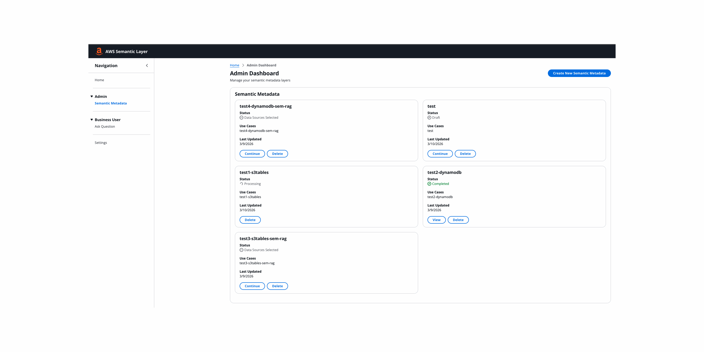
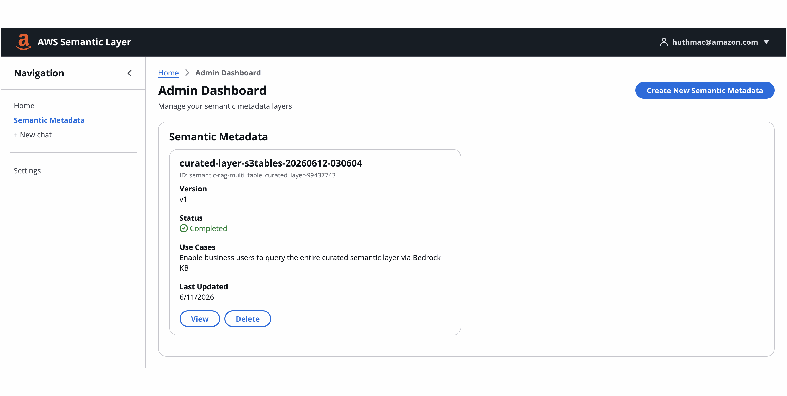
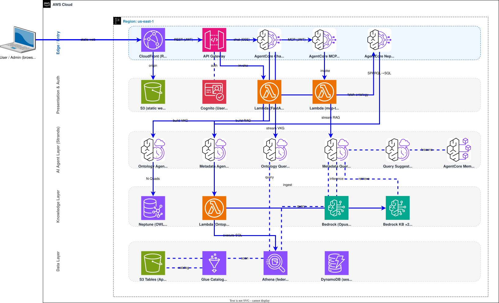

# Sample Semantic Layer for Structured Data

## Overview

This sample architecture illustrates three alternative semantic layer approaches for structured data:

1. **Virtual Knowledge Graph (VKG)**: OWL ontology stored in Amazon Neptune; natural language queries are translated to SQL via ontology mappings
2. **Semantic RAG**: Semantic metadata stored in Amazon Bedrock Knowledge Base; natural language queries use RAG for context-aware SQL generation
3. **Hybrid** (on by default, `-c enableHybrid=false` to drop it): a **thin structural VKG** in Neptune (classes, columns, joins) for grounding plus **rich prose** in a Bedrock Knowledge Base for values and business meaning — the _vector-assist in, ontology-verify out_ pattern. SQL is generated from the retrieved prose, then every `(subject_class, predicate)` pair it touches is verified against the graph's `rdfs:domain` before execution. Implemented as two self-contained agents with zero imports from the other five, so VKG and Semantic RAG are untouched

All three approaches share the same admin workflow up to the point of choosing the semantic layer type.

> **📊 Background / concepts:** For the _why_ behind this project — the two failure modes of
> agentic text-to-SQL (grounding vs. delivery), how a semantic layer + ontology and progressive
> disclosure address them, and the tiered query path — see the companion presentation
> [`assets/guides/semantic-layer.pptx`](assets/guides/semantic-layer.pptx).

### Key Capabilities

- **Three Semantic Layer Modes**: Choose VKG (Neptune-based ontology), Semantic RAG (Bedrock KB-based metadata), or Hybrid (thin structural VKG for grounding + KB prose for values). All three are on by default
- **AI-Powered Metadata Enrichment**: Automated descriptions for databases, tables, and columns written back to Glue Data Catalog and S3 Tables metadata
- **AI-Assisted Metadata Generation**: Versioned, iterative semantic layer creation with human in the loop
- **Natural Language Queries**: Query data across sources using plain English
- **Multi-Turn Conversational Chat**: Streaming AG-UI chat with persisted session history, per-turn reasoning trace, and follow-up context (DynamoDB-backed transcripts)
- **MCP Server**: An AgentCore Gateway exposes the query agents as MCP tools (`ListOntologies`, `OntologyQuery`, `MetadataQuery`, `QuerySuggestions`) to Claude Code, Cowork, Cursor, VS Code, and other MCP clients over OAuth 2.0 — see [`assets/guides/MCP_SERVER.md`](assets/guides/MCP_SERVER.md)
- **User Feedback**: 👍/👎 ratings + comments per assistant turn, PII-redacted by Guardrails and stored in DynamoDB; surfaced in the admin Feedback tab
- **Lessons Learned / Long-Term Memory**: Bedrock AgentCore Memory mines durable lessons from chat sessions (SemanticStrategy) and injects them as prior context into future queries; surfaced in the admin Lessons Learned tab
- **Ground-Truth Evaluations**: Per-layer ground-truth datasets drive AgentCore on-demand + online evaluation runs (accuracy / latency / token metrics) surfaced in the admin Evaluations tab
- **Production Monitoring**: Read-only admin Monitoring tab reporting how live queries resolved per layer — bucketed by each answer's persisted `provenance.tier` into metric / rule / semantic / advisory / document / agentic resolution layers — plus a correction-language rate (share of user turns that read as a correction) correlated with the count of lessons AgentCore Memory has extracted
- **Three-Tier Query Path**: A Tier 1 **governed-metric lookup** first matches the question (Titan-v2 embedding + KNN, cosine ≥ 0.85) against maintained/published metrics and, on a clear match, runs that metric's pre-validated SQL on Athena — returning early. On a miss, a **governed-rule tier** (VKG and Hybrid — the two layer types that build a graph; same 0.85 KNN threshold) gets the next look. Otherwise it falls through to a Tier 2 deterministic Strands graph (topic router → disambiguation → slice builder → SQL/SPARQL generate+validate → grounding gate + bounded execution) with clarification loops. If Tier 2 **degrades**, a Tier 3 **supervisor-loop agentic fallback** reasons freely over the layer to recover an answer — bounded by rounds _and_ a per-round tool-call/wall-clock budget. When no table can serve the question at all, a **document terminal** answers in prose from the layer's uploaded documents, citing file and page — the same call in all three layer types, which is what lets a document-only layer be queryable (see [Document Pipeline](#document-pipeline-supplementary-docs--kb))
- **Maintained Metrics (governed)**: curated metrics (name/description/synonyms + pre-validated SQL) stored in DynamoDB with a DRAFT → APPROVED → PUBLISHED lifecycle; published metrics are embedded for the Tier 1 lookup and authored via the `/metrics` API (gated by `METRICS_TABLE`)
- **Governed Rules (ontology-native)**: the conditional sibling of a governed metric — conditions, thresholds, an outcome, and the epistemic strength the source document actually claimed, stored as RDF in a sibling Neptune named graph (no new table). Mined from uploaded policy documents by the `ruleminer` pipeline stage as unapproved DRAFTs, gated by four-level validation (structural / semantic / operational / epistemic) plus a live Ontop+Athena smoke query at publish, and reviewed in the admin **Governed Rules** tab. A rule with an unmapped input or an unapproved threshold answers **advisory with a named knowledge gap** rather than guessing the bound. Flag-gated on `enableGovernedRules` (default `true`); **VKG and Hybrid** layers (both emit the `vkg:mapsToTable`/`mapsToColumn` mappings Ontop needs) — a Semantic RAG layer builds no graph for a rule to bind to. See [`assets/guides/GOVERNED_RULES.md`](assets/guides/GOVERNED_RULES.md)
- **Namespaces, Authorization & a SQL Firewall**: a namespace is a real primitive (record, owner, lifecycle, name uniqueness, per-namespace Athena workgroup) that permissions attach to, not a string in a URL. Every REST request passes an **ASGI Cedar policy-decision point** whose coverage is structural — an unmapped route denies — resolving six roles (`platform-admin`/`-viewer`, `namespace-owner`/`-maintainer`/`-data-steward`/`-data-analyst`) from Cognito groups plus a DynamoDB grants table. At execution time a **SQL firewall** enforces SELECT-only structurally (deep AST scan, so a `DELETE` inside a CTE is caught) and applies deny-wins `tableAllowlist`/`columnDenylist`/`allowedMetrics` restrictions. Install and enforce are separate switches, so the PDP can be deployed dark and armed second (`enableAuthz`, default `false`)
- **Ontology in Neptune**: Business concepts, relationships, and mappings stored as RDF/OWL
- **Data in Source Systems**: Actual data remains in source systems
- **Query Translation**: AI agents use semantic layer to translate natural language into SQL/SPARQL queries (VKG: SPARQL→SQL via Ontop reformulation on Athena)

## Demo

### Virtual Knowledge Graph Flow



### Semantic RAG Flow



## Architecture



## Technology Stack

### Frontend

- **Framework**: React 18
- **UI Library**: AWS Cloudscape Design System 3.0
- **Authentication**: AWS Amplify Auth (Cognito)
- **HTTP Client**: Axios (`^1.16.0`)
- **Routing**: React Router v6
- **Streaming Chat**: AG-UI Server-Sent Events (SSE) over fetch + ReadableStream, streamed directly through the Chat AgentCore Gateway (JWT)
- **Hosting**: CloudFront + S3

### Backend & Infrastructure

- **Infrastructure as Code**: AWS CDK v2 (TypeScript)
- **API Layer**: AWS Lambda with Python FastAPI
- **AI Framework**: Strands Agents SDK
- **LLM**: Amazon Bedrock
- **Container Registry**: Amazon ECR
- **Agent Runtime**: Amazon Bedrock AgentCore Runtime (7 runtimes on a default deploy — 5 core + 2 Hybrid, the latter under `enableHybrid`)
- **Agent Gateways**: Amazon Bedrock AgentCore Gateway — MCP server (tools), MCP OAuth proxy, streaming chat, and Neptune/Ontop SPARQL→SQL
- **Long-Term Memory**: Amazon Bedrock AgentCore Memory (SemanticStrategy) for lessons-learned mining
- **Agent Evaluation**: Amazon Bedrock AgentCore Evaluation (on-demand batch + online sampling) against per-layer ground-truth datasets
- **SPARQL→SQL Translation**: Ontop reformulation (Java 21 Lambda on the Neptune Gateway)

### Data & Knowledge Layer

- **Graph Database**: Amazon Neptune (RDF/SPARQL) — VKG mode
- **Vector Store**: Amazon Bedrock Knowledge Base (S3 Vectors) — ontology-patterns (VKG) + semantic-rag (Semantic RAG)
- **Operational Data**: Amazon DynamoDB (12 insurance tables)
- **Application State**: Amazon DynamoDB — `semantic-layer-metadata` (ontology/job state), `…-chat-sessions` (multi-turn transcripts, TTL), `…-feedback` (👍/👎 + comments), `…-metrics` (governed metrics + embeddings, Tier 1), `…-namespaces` (namespace records + name reservations, `NameByIndex` GSI) and `…-grants` (role grants + data restrictions, `PrincipalIndex` GSI) tables. Governed **rules** deliberately add
  no table — they are RDF in a sibling Neptune named graph (see [Governed Rules](#governed-rules-ontology-native-conditional-logic))
- **Analytical Data**: Amazon S3 Tables (Apache Iceberg format)
- **Real-Time CDC**: DynamoDB Streams → Lambda (PyIceberg) → S3 Tables
- **Batch Replication**: AWS Glue Zero-ETL integration
- **Normalized Views**: AWS Glue 5.1 Materialized Views (40 Iceberg MVs in `normalized` namespace)
- **Metadata Catalog**: AWS Glue Data Catalog (AI-enriched descriptions)
- **Query Engine**: Amazon Athena (with DynamoDB Connector + S3 Tables catalog + a Snowflake
  federated connector, on by default)

### Security & Observability

- **Authentication**: Amazon Cognito (OAuth 2.0 + PKCE); CUSTOM_JWT authorizers on the MCP/chat gateways; M2M `client_credentials` for backend service-to-runtime calls
- **Authorization**: Cedar policies (`cedarpy`) evaluated by an ASGI policy-decision point on the FastAPI root app — six roles resolved from Cognito groups + a DynamoDB grants table, fail-closed on an unmapped route or a malformed policy (`enableAuthz`)
- **Query-time data controls**: a serve-time SQL firewall at every user-influenced Athena execution site — always-on SELECT-only structural checks plus deny-wins per-grant table/column/metric restrictions
- **AI Safety**: Amazon Bedrock Guardrails (INPUT/OUTPUT screening on queries; PII redaction on feedback + memory writes)
- **Observability**: AWS OpenTelemetry Distro; AgentCore online + on-demand evaluation; CloudWatch custom chat metrics
- **Secrets**: AWS Secrets Manager + Systems Manager Parameter Store
- **Network**: Lake Formation permissions for S3 Tables access control

## User Stories & Features

### Admin Flow

#### 1. Describe Application Intent

**Implementation**: `frontend/src/pages/admin/DescribeIntent.jsx`

- Text input for data source descriptions and business use cases
- Stores configuration in DynamoDB `semantic-layer-metadata` table

#### 2. Select Data Sources

**Implementation**: `frontend/src/pages/admin/SelectDataSources.jsx`

- Multi-select from Glue Catalog databases/tables (including S3 Tables/Iceberg)
- Optional file upload for existing ontology/documentation
- Each selected table includes its Athena `catalogId` for federated routing

#### 3. Review Metadata

**Implementation**: `frontend/src/pages/admin/ReviewMetadata.jsx`

- Read-only view of Glue Catalog metadata (tables, columns, data types)

#### 4. Select Semantic Layer Type ^1

**Implementation**: `frontend/src/pages/admin/SelectSemanticLayerType.jsx`

- **VKG**: Generates OWL ontology stored in Amazon Neptune and Amazon S3
- **Semantic RAG**: Generates AI metadata stored in Amazon Bedrock Knowledge Base and Amazon S3
- **Hybrid** ^4: Generates both — a thin structural VKG in Neptune _and_ a rich Bedrock KB — via the
  Hybrid creation agent (`buildingKB → buildingVKG → completed`). Like VKG, it routes to
  `/admin/build-graph`, which reads the stored `type` and dispatches to the Hybrid build path

^4 The Hybrid card requires `enableOntologyAgents`, `enableSemanticRag`, **and** `enableHybrid` —
all three, since Hybrid draws on both underlying modes and needs its own two runtimes. All three
default to `true`, so the card is shown on a default deploy

#### 5a. Build Knowledge Graph (VKG **and Hybrid** paths) ^1

**Implementation**: `frontend/src/pages/admin/BuildKnowledgeGraph.jsx`

- One page, two agents: `POST /ontology/build/{ontology_id}` routes on the stored `type`, and the
  page reads that same `type` so the wording describes the agent that is actually running
- **VKG** progress: extracting metadata → retrieving patterns → generating OWL → loading to Neptune
- **Hybrid** progress: the two phases the creation agent really runs — document each table into the
  Bedrock Knowledge Base (`buildingKB`), then map its structure into the thin VKG (`buildingVKG`).
  The table counter reads "documented" then "mapped" (both phases count the same tables), and a
  failure names its phase: `failed:vkg` leaves the Knowledge Base documents written and only the
  graph missing, which `failed:kb` does not
- **Hybrid status tokens.** The poll loop matches the creation agent's own vocabulary
  (`buildingKB` / `buildingVKG`, and `failed:` as a _prefix_ so `failed:kb` / `failed:vkg` terminate
  polling). Before this, a Hybrid build sat on "Initializing" for its whole duration and a failed
  one polled forever with no error shown
- A newly started build **clears the previous attempt's error and progress fields** before it goes
  `pending` (`OntologyService._clear_previous_build_results`), because
  `GET /ontology/build-status` returns `error` unconditionally — so a running build can never poll as
  "in progress, and here is the last run's failure", which from the UI is indistinguishable from
  failing again immediately
- The type lookup **fails soft**: if it cannot be read, the page keeps the VKG wording. VKG copy is
  unchanged

#### 5b. Build Semantic Metadata (Semantic RAG path)

**Implementation**: `frontend/src/pages/admin/BuildSemanticMetadata.jsx`

- Triggers Metadata Agent via Lambda API
- Progress polling: per-table status with `tablesProcessed / totalTables`
- Agent writes descriptions to Glue Catalog and saves Markdown docs to S3/KB

#### 6. View Results & Manage the Layer

The admin detail screen (`ViewKnowledgeGraph.jsx` for VKG, `ViewSemanticRAGMetadata.jsx` for
Semantic RAG) hosts tabbed management surfaces:

- **Metadata / Knowledge Graph**: ontology editor (VKG graph visualization ^1) or enriched metadata view
- **Data Sources**: the tables backing the layer
- **Governed Metrics** (`frontend/src/components/GovernedMetricsTab.jsx`): author/approve/publish the curated Tier 1 metrics (mounted only when `METRICS_TABLE` is set)
- **Governed Rules** (`frontend/src/components/GovernedRulesTab.jsx`, VKG and Hybrid — the supported set lives in `frontend/src/utils/layerCapabilities.js`, once): review mined conditional rules as a form — per-threshold approval, the four validation reports, the five generated test cases, Publish gated on all of them (`enableGovernedRules`). Rules the API could not deserialize are surfaced as a warning banner naming each one, rather than being omitted from a list that would otherwise look complete
- **Feedback** (`frontend/src/components/FeedbackTab.jsx`): per-turn 👍/👎 ratings + comments collected from chat, PII-redacted by Guardrails
- **Lessons Learned** (`frontend/src/components/LessonsLearnedTab.jsx`): long-term lessons mined from chat sessions by AgentCore Memory
- **Ground Truth** (`frontend/src/pages/admin/GroundTruthDataset.jsx`): upload/inspect the per-layer evaluation dataset
- **Evaluations** (`frontend/src/pages/admin/Evaluations.jsx`): AgentCore evaluation runs (accuracy / latency / token metrics)
- **Monitoring** (`frontend/src/components/MonitoringTab.jsx`): live query-resolution breakdown (metric / rule / semantic / advisory / document / agentic) bucketed by each answer's persisted `provenance.tier`, plus a correction-language rate correlated with extracted lessons
- **Supplementary Docs** (`frontend/src/pages/admin/UploadSupplementaryDocs.jsx`): upload reference docs into the doc-pipeline → KB; handled identically for all three layer types and answerable in prose — see [Document Pipeline](#document-pipeline-supplementary-docs--kb)

^1 Optional: If "enableOntologyAgents": false, then this screen is disabled and SemanticRAG is selected as default

### End User Flow (Querying)

#### Conversational Chat (multi-turn)

**Implementation**: `frontend/src/pages/query/` — `AskQuestion.jsx` (route), `LandingPage.jsx`
(layer picker + empty-state composer), `ChatView.jsx`, `ChatTranscript.jsx`, `Composer.jsx`,
`ReasoningPanel.jsx`, `ResultPanel.jsx`, `FeedbackBar.jsx`; state machine in
`frontend/src/hooks/useChatStream.js`, sidebar history in `useChatSessions.js`.

- **Streaming, multi-turn chat**: AG-UI events stream over SSE directly through the Chat
  AgentCore Gateway (JWT). Transcripts persist in the `chat-sessions` DynamoDB table (TTL 24h),
  so refreshing or clicking a past session in the sidebar rehydrates the conversation.
- Routes to the correct query agent based on layer type:
  - **VKG**: Ontology Query Agent — Neptune topic routing → SPARQL → **Ontop SPARQL→SQL** → Athena
  - **Semantic RAG**: Metadata Query Agent — KB slice retrieval → SQL → Athena
- **Per-turn reasoning trace**: the tiered workflow emits phase events (router, disambiguation,
  slice builder, SQL/SPARQL generate+validate, grounding/execution) rendered in `ReasoningPanel`,
  including the executed SQL, result table (CSV download), and the Semantic-RAG slice (JSON
  download).
- **Per-turn feedback**: 👍/👎 with an optional comment writes to `POST /query/feedback`.
- **Dynamic Suggested Questions**: selecting a layer calls `GET /query/suggestions/{id}` for 3
  AI-generated questions from the Query Suggestions Agent, shown with category labels.

## Data Sources

> **🧪 Sample structure, synthetic data.** This is a **reference data model**, not a real
> dataset. The 12 operational tables follow the **ACORD** insurance data standard (an industry
> reference schema) and are populated entirely with **synthetic, machine-generated data** — no
> real customer, policy, or financial records. The data is produced by
> [`scripts/generate_complete_synthetic_data.py`](scripts/generate_complete_synthetic_data.py)
> and loaded via [`scripts/load_to_dynamodb.py`](scripts/load_to_dynamodb.py) when
> `enableAcordSampleData` is set — **on by default** in the committed `cdk.json`; deploy with
> `-c enableAcordSampleData=false` to skip the synthetic rows (see [Deployment Modes](#deployment-modes)).
> Adapt the schema and loaders to your own structured sources to reuse the semantic-layer
> architecture.

### 1. DynamoDB - Operational Data (12 tables)

`HOLDING`, `PARTY`, `COVERAGE`, `RIDER`, `RELATION`, `FINANCIALACTIVITY`, `FINANCIALSTATEMENT`, `POLICYPRODUCT`, `COVERAGEPRODUCT`, `INVESTPRODUCT`, `TYPE_CODES`, `ADMIN_CODES`

**Access**: Athena with DynamoDB Connector (`lambda:` catalog)

### 2. S3 Tables (Apache Iceberg) - Analytical Data

**Real-time CDC pipeline** ^2

```
DynamoDB Streams → Lambda (PyIceberg) → S3 Tables (Iceberg)
                                         ↑
                   Glue Zero-ETL (batch) ─┘
```

- Sub-second latency via DynamoDB Streams + Lambda
- True schema evolution via Iceberg spec
- UPSERT/DELETE support via PyIceberg atomic operations
- Registered as `s3tablescatalog` catalog in Athena
- Governed via Lake Formation

^2 Optional: Enabled if "enableRealtimeReplication": true

**Batch pipeline** (alternative to the real-time CDC pipeline) ^3

```
DynamoDB table → Zero-ETL integration → S3 Tables (zetl_<uuid> namespace)
                                                  ↓
                                        Glue 5.1 Materialized Views
                                                  ↓
                                        S3 Tables (normalized namespace)
                                        └─ 40 entity tables (holding, party,
                                           coverage, rider, relation, ...)
```

- Glue Zero-ETL integration per DynamoDB table → S3 Tables (`zetl_<uuid>` namespace per integration)
- **NormalizedViewsStack**: Glue 5.1 PySpark job creates 40 Iceberg Materialized Views in a `normalized` namespace, applying `sk LIKE '<Prefix>#%'` filters to demultiplex each flat Zero-ETL table into its constituent entity tables
- Scheduled refresh every 6 hours via EventBridge; incremental Iceberg refresh where possible
- `zetl_*` namespaces are internal replication staging — the `normalized` namespace is the user-facing analytical layer

^3 Optional: Enabled if "enableBatchReplication": true

## AI Agents (Strands Framework)

### 1. Ontology Generation Agent (VKG)

**Location**: `agents/ontology_agent/main.py`

**Purpose**: Generates OWL ontologies from Glue schemas and table sampling using user-provided documentation and sample ontology patterns retrieved via RAG from Bedrock KB.

**Three sub-agents**: Phase 1 (per-table N-Quads), Phase 2 (FK refinement + Neptune persist), Revision (targeted edits)

**Phase 1 tools** (per-table, fresh agent per table):

```python
get_single_table_schema(database_name, table_name, catalog_id)  # Athena DESCRIBE + Glue fallback
sample_table_data(database_name, table_name, catalog_id)        # Athena SELECT + DynamoDB fallback
retrieve_ontology_patterns(schema_description, max_patterns)    # RAG from Bedrock KB
download_document_from_s3(s3_path)                             # download reference docs
search_document(file_path, search_term, context_lines)
read_document_lines(file_path, start_line, num_lines)
append_nquads(ontology_id, table_name, nquad_batch)            # batched N-Quad writing (≤70 lines)
save_intermediate_ontology(ontology_id, table_name, ...)       # finalize + S3 save
update_progress(ontology_id, tables_processed, total_tables, current_table)
```

**Phase 2 tools** (per-table, fresh agent per table):

```python
append_fk_triples(ontology_id, table_name, fk_nquads)         # add FK ObjectProperty triples
persist_file_to_neptune(ontology_id, table_name)               # read file → AgentCore GW → Neptune
update_glue_metadata_from_ontology(ontology_id, database_name, table_name, catalog_id)
```

**Assembly** (Python, not agent): concatenate all per-table N-Quads → save consolidated `ontology.nq` to S3

**Post-assembly**: write Iceberg column doc strings + table descriptions to S3 Tables metadata via pyiceberg

**Revision tools**: `download_document_from_s3`, `search_document`, `read_document_lines`, `apply_targeted_edits`, `persist_revision_from_s3`

**Output**: N-QUADS in Neptune named graphs (via AgentCore Gateway) with `mapsToTable`/`mapsToColumn` traceability predicates; column descriptions written to Glue Data Catalog and Iceberg S3 metadata.

### 2. Metadata Generation Agent (Semantic RAG)

**Location**: `agents/metadata_agent/main.py`

**Purpose**: Create semantic metadata and save it in Glue Catalog, S3 Table metadata, and as markdown metadata documents to S3 for Bedrock KB ingestion. Supports two operational modes: **standard enrichment** and **annotation-only revision**.

**Tools** (shared by both modes):

```python
get_single_table_schema(database_name, table_name, catalog_id)
sample_table_data(database_name, table_name, catalog_id)
download_document_from_s3(s3_path)
search_document(file_path, search_term, context_lines)
read_document_lines(file_path, start_line, num_lines)
update_glue_table_metadata(database_name, table_name, table_description, column_descriptions, catalog_id)
update_glue_database_description(database_name, description)
save_metadata_document_to_s3(database_name, table_name, catalog_id, metadata_content)
update_progress(job_id, tables_processed, total_tables, current_table)
```

**Standard enrichment workflow** (per table, fresh agent per table):

1. For each unique database: write AI description to Glue
2. For each table: DESCRIBE schema → sample data (+ reference docs if uploaded) → generate descriptions → write to Glue & S3 Table Metadata → save Markdown to S3 → update progress
3. After all tables: trigger Bedrock KB ingestion job
4. Returns immediately (async); status polled via `jobId` in DynamoDB

**Annotation mode** (`ANNOTATION_SYSTEM_PROMPT`): Triggered when `annotations` are included in the enrichment payload. Skips data sampling and reference docs. Reads existing Glue descriptions as baseline, applies targeted per-column/per-table annotation hints, leaves all non-targeted descriptions unchanged, and rewrites the S3 Knowledge Base document.

**Versioning** (pointer + history pattern): Mirrors the ontology agent. When `revisionMode=True`:

1. Service stamps v1 with `revisionMode`, `targetVersion` (e.g. `v2`), and `revisionInstructions`
2. Agent runs enrichment/annotation as normal
3. On completion: `_write_versioned_completion()` writes an immutable history record (SK = `v2`) then updates v1 as the mutable current pointer (`currentVersion = v2`, `revisionMode = False`)

**Federated catalog routing**: The `catalogId` per table (e.g. `s3tablescatalog/<bucket>`) is resolved automatically. For S3 Tables, `versionToken` is fetched from the S3 Tables API on Glue update conflicts (retry-on-exception pattern).

### Incremental (delta) builds

Both build agents (Ontology + Metadata) support **incremental rebuilds** so a re-run reprocesses only the tables that actually changed instead of rescanning every selected table.

- **Check for updates**: a manual button on the View screen (`DeltaPreview`, mounted in the Data Sources / Metadata tabs) calls the REST-API planner (`DeltaPlannerService`), which computes a per-table diff of the current selection against per-table fingerprints stored in the config record. The diff classifies each table as **added / removed / schema-changed / data-changed / unchanged** and returns a preview with a per-table reason before any build runs.
- **Fingerprints**: `schemaHash` (ordered column name + normalized type + comment-present flag; partition keys merged; comment _text_ excluded) plus a `dataMarker` — the **Iceberg snapshot-id** for S3 Tables (exact), or **DynamoDB `ItemCount` + Athena `COUNT(*)`** for DynamoDB-connector tables (coarse). Agents and planner import the same fingerprint functions from `agents/shared/delta_fingerprint.py`, so a table the agent just built diffs as `unchanged` on the next check.
- **Scoped rebuild**: on confirm, only the affected tables are rebuilt (`scope=delta` with `targetTables`). For **VKG**, the changed set is expanded to its **FK-neighbor closure** so cross-table relationships stay consistent; ontology assembly still reads the full unfiltered set of per-table fragments, so the assembled ontology remains complete.
- **Removal cleanup**: removed tables have their artifacts cleaned up — KB metadata doc (Semantic RAG) or Neptune triples + S3 fragment (VKG).
- **Full rebuild** remains available as an escape hatch (`scope=full`, the default legacy behavior).
- **Known limitation**: DynamoDB-connector tables use a **coarse row-count marker**, so **value-only changes at a stable row count are not detected**. This is surfaced in the diff preview per-table detail; use a full rebuild when in doubt.

### 3. Ontology Query Agent (VKG)

**Location**: `agents/ontology_query_agent/main.py` (+ `tier2/` workflow, shared graph in `agents/shared/tier2_graph.py`)

**Tier 1 — governed-metric lookup** (`agents/shared/metric_lookup.py` + `metric_executor.py`):
before the graph runs, the question is embedded (Titan v2) and KNN-matched against published
maintained metrics for the namespace. On a clear hit (cosine ≥ 0.85) the metric's pre-validated
`compiled_sql` is executed on Athena and the answer is returned early — short-circuiting Tier 2.
Any miss or error falls through (fail-soft). The response is shaped like a Tier 2 result
(`metadata.tier = 1`), so the UI is tier-agnostic. This cascade is identical in the
Semantic-RAG agent below.

**Tier 2 — Strands-graph workflow** (`agents/ontology_query_agent/tier2/workflow.py`), run only
when Tier 1 finds no match:

```
Phase 1  Topic router          KNN/lexical → candidate class + property IRIs
Phase 2  Term disambiguation   term → IRI; >1 class IRI → clarification
Phase 3  Slice builder + judge  SPARQL CONSTRUCT (n-hops) → Turtle slice
Phase 3b Slice disambiguation   property collision / multi class-path
Phase 4  SPARQL generate + validate (rdflib parseQuery + 1 repair)
Phase 5  Grounding gate → Ontop SPARQL→SQL translate → Athena execute (+ SQL repair)
```

- Grounding back-edge: an out-of-slice-but-real IRI loops to Phase 3 (expand the slice); a
  hallucinated/misused IRI loops to Phase 4 (regenerate with feedback).
- **Phase 5 execution**: the grounded SPARQL is lineage only (Neptune is schema-only); the
  `translate_sparql_to_sql` Ontop Lambda (Java, on the Neptune Gateway) reformulates it to Athena
  SQL, which the agent executes — with a bounded LLM SQL-repair retry on Athena failures.
- **Dynamic row limits**: default 10, user-specified (e.g. "top 30"), max 100.

**Tier 3 — supervisor-loop agentic fallback** (`agents/ontology_query_agent/tier3/`), entered only
when Tier 2 **degrades** (`wf.degraded` set): a bounded worker → judge → retry loop that reasons
freely over the ontology to recover an answer the structured SPARQL path missed. Never fabricates —
on exhaustion it keeps Tier 2's honest degraded answer.

- **Two hard bounds per round** (`tier3/budget.py`), because either alone leaves a hole:
  `DEFAULT_MAX_TOOL_CALLS = 40` catches the fast-spin case (hundreds of cheap calls burning the wall
  clock) and `DEFAULT_ROUND_SECONDS = 240.0` catches the slow-spin case. The supervisor separately
  bounds worker _rounds_ (`DEFAULT_MAX_ROUNDS = 3`).
- **Why a budget was required**: a Strands ReAct loop has no iteration cap of its own, and a plain
  `Exception` raised inside a `@tool` is handed back to the model as a tool _result_ — so the model
  retries forever. `WorkerBudgetExceeded` therefore derives from `BaseException` so it unwinds the
  agent call. This was the measured cause of the BIRD eval timeouts (123/500 rows on the 2026-08-07
  run: one session issued 157 `translate_sql` calls in a single round and never reached round 2).

### 4. Metadata Query Agent (Semantic RAG)

**Location**: `agents/metadata_query_agent/main.py` (+ `tier2/` workflow, shared graph in `agents/shared/tier2_graph.py`)

**Purpose**: Answers natural-language questions over the Semantic-RAG layer using the same
two-tier cascade as the VKG agent — **Tier 1 governed-metric lookup** first (see §3), then the
Tier 2 Strands graph specialized for KB-backed metadata when no metric matches:

```
Phase 1  Topic router          KB retrieval → candidate tables (+ scores)
Phase 2  Term disambiguation   term → table; ambiguity → clarification
Phase 3  Slice builder + judge  parse KB markdown chunks → JSON slice
                                (tables/columns/joins/acord_paths/query_patterns)
Phase 3b Slice disambiguation   slice-level collision → clarification
Phase 4  SQL generate + validate (sqlglot parse + 1 repair)
Phase 5  Grounding gate → bounded execution agent → Athena execute
```

- The Phase 3 slice (the grounding context) is surfaced to the chat UI for view + JSON download.
- Grounding back-edge loops to Phase 4 (a hallucinated column can't be fixed by widening the slice).

Both query agents also carry the **Tier 3** supervisor-loop fallback described in §3
(`agents/metadata_query_agent/tier3/`), with the same per-round budget.

### 5. Query Suggestions Agent

**Location**: `agents/query_suggestions_agent/main.py`

**Purpose**: Generates 3 dynamic, contextually relevant suggested questions for the Natural Language Query UI by retrieving schema context from the Bedrock Knowledge Base for the selected semantic layer.

**Tools**:

```python
retrieve_kb_context(user_query)   # retrieves schema docs from Bedrock KB (top 10 results)
```

**Workflow**:

1. Receives `{"id": "<ontology_config_id>"}` payload from AgentCore entrypoint
2. Looks up the metadata config name from DynamoDB
3. Agent calls `retrieve_kb_context("list all available tables and their columns and business purpose")`
4. LLM analyses schema context and generates 3 categorised questions
5. Returns `{"suggestions": [{"category": "...", "question": "..."}, ...]}`

**Invocation**: Synchronous — no polling required. Called via `GET /query/suggestions/{ontology_id}`.

### 6. Semantic Layer Creation Agent (Hybrid) — `enableHybrid`

**Location**: `agents/semantic_layer_creation_agent/main.py`

**Purpose**: Builds **both** halves of a Hybrid layer sequentially, with a two-phase build status:

```
buildingKB  →  buildingVKG  →  completed
```

- **`kb_builder.py`** writes the **rich prose** — business purpose, synonyms, reference tables,
  sample SQL, sample data, notes — into the Bedrock Knowledge Base. `athena_probe.py` runs a value
  probe **per column** so the prose describes real values, not just column names (this is what makes
  the KB phase the slow half; the build budget in `scripts/build_hybrid_layer.py` scales per table).
- **`vkg_builder.py`** emits the **thin structural VKG** — classes, columns, relationships, and one
  capped `rdfs:comment` line each; the prose _sections_ stay in the KB — which `neptune_load.py`
  loads into Neptune as the layer's named graph, reaching Neptune **only through the AgentCore
  Gateway** (the agent has no VPC path of its own). The layer's graph is **dropped before it is
  re-loaded** (`delete_graph`): `persist_to_neptune` issues `INSERT DATA` only, and RDF set
  semantics make an unchanged re-load _look_ idempotent, so without the clear anything a rebuild no
  longer emits survives it — a renamed inferred edge left the superseded property in Neptune and the
  viewer and query side both saw relationships the current build never produced. **A failed clear
  fails the build**: loading on top of a graph that could not be cleared silently mixes two builds.
- **`fk_inference.py`** derives those relationships. There is no FK metadata to read — Glue's
  `get_table` returns none, Iceberg exposes none — so edges are derived deterministically from the
  **table and column names of the layer's own tables**, on tokenized names rather than substrings
  (a substring rule reads `valid`/`hybrid` as "ends in id"): a directed **reference rule**
  (`cards.setCode` → `sets.code`, the target namable by a suffix of the prefix tokens so
  `origin_airport_id` → `airports` resolves too) and a symmetric **shared-identifier rule** (one
  identifier column held by 2–6 tables, excluding each table's own surrogate key). Unmatched or
  out-of-layer references are dropped, not guessed. Unbroken lowercase runs are re-segmented first,
  because the catalog folds `setCode` to `setcode` and destroys the word boundary the rules need —
  guarded by `NO_SPLIT_TOKENS` (`sk`/`fk`/`ref`, since `risk`/`task`/`desk` all end in `sk`) and
  `MIN_SEGMENT_LENGTH` (so `valid` is not read as `val` + `id`, while `multiverseid` still splits).
  An edge only becomes a real SQL join if the target class **declares** the referenced column as its
  key — and declaring a key also licenses Ontop to drop de-duplication — so
  `athena_probe.probe_unique_columns` **measures** uniqueness
  (`COUNT(DISTINCT c) = COUNT(c) = COUNT(*)`, one query per table) instead of assuming it; a failed
  probe declares no key at all.
- **`kb_descriptions.py`** harvests one capped line per class and per column back out of the KB
  markdown (the `## Overview` paragraph and the `## Columns` table) and re-emits it as
  `rdfs:comment`, so the admin Metadata tab has descriptions to render rather than a column of
  em-dashes. One line is the whole budget: the query path's `CONSTRUCT` sweeps **every** predicate on
  a candidate class into the ontology slice, so a full prose section per class would duplicate KB
  retrieval in every prompt. Stdlib only, and never raises on a malformed document — descriptions
  are additive and cannot break grounding.
- **Progress and artifact.** `progress.py` carries `totalTables` / `tablesProcessed` /
  `currentTable` / `progressPercent` (not just `status`) across a two-phase bar, and the assembled
  thin VKG is **also** written to `s3://<artifacts>/ontologies/<id>/ontology.nq` and stamped as
  `metadataPath` — the Metadata tab reads that S3 artifact, not Neptune.
- **Full builds only.** Hybrid ignores the delta-rebuild params (`scope` / `targetTables`) that the
  VKG and Semantic-RAG build paths honour; every Hybrid build rebuilds both halves.

**Invocation**: `{"id": "<layer-id>"}`; the work runs on a background thread with OTel baggage
propagated so Evaluations can find the session's spans. `_build_hybrid` is a deliberately
**non-raising** orchestrator that records `failed:<phase>` and returns an outcome dict; the
entrypoint is what flips DynamoDB to `failed` and re-raises so AgentCore records the failure.

The admin wizard drives this path end to end: the Hybrid card in `SelectSemanticLayerType.jsx`
routes to `/admin/build-graph`, which posts to `POST /ontology/build/{id}`, polls the two-phase
status (§5a), and lands on `/admin/view-graph`.
[`scripts/build_hybrid_layer.py`](scripts/build_hybrid_layer.py) is the **headless** equivalent of
that flow (copy a reference layer's `dataSources`, seed the `hybrid-*` config, invoke the runtime,
poll to a terminal status) and additionally **verifies the graph actually landed**: a non-empty
Neptune graph _with_ `mapsToColumn` triples. A classes-only graph looks like a successful build but
cannot ground a single column reference, so it is treated as a failure.

### 7. Semantic Layer Query Agent (Hybrid) — `enableHybrid`

**Location**: `agents/semantic_layer_query_agent/main.py` (+ `graph.py` for the Tier-2 workflow)

**Purpose**: Answers questions over a Hybrid layer — generate SQL from the KB prose, then verify it
against the structural graph before running it.

```
Phase 1  Recall router          KNN retrieval → candidate tables
Phase 2  Term disambiguation    ambiguous term → clarification
Phase 3  Slice builder + judge loop
Phase 3b Slice disambiguation   slice-level collisions → clarification
Phase 4  SQL generate           NL → SQL, negative-constraint aware
Phase 5  Ontology-verified grounding gate + bounded execution
```

**Phase 5 is the Hybrid-specific part.** Where the Semantic-RAG agent grounds SQL by flat
set-membership against a JSON slice, the Hybrid agent fetches the thin-VKG structural graph from
Neptune, bridges the generated SQL into ontology `(subject_class, predicate)` triples
(`sql_ontology_bridge.py`), and verifies each triple against that predicate's **`rdfs:domain`**
(`grounding.py`). A predicate used against the wrong class — or absent from the slice — is a
grounding miss that loops back to Phase 4 to regenerate the SQL with the miss threaded in as a
negative constraint.

- Bounded by `MAX_GROUNDING_ROUNDS = 2`; exceeding it **abstains** via the degraded terminal rather
  than executing un-grounded SQL. `MAX_NODE_EXECUTIONS = 40` is the global graph backstop.
- A graph-fetch failure **fails loud** (`hybrid_verify_unavailable`) — never a silent single-engine
  answer, which would be indistinguishable from a verified one.

**Measured trade-off** (2026-08-07, 16-row curated ground truth, k=3): Hybrid is the **fastest and
cheapest** arm — 24.4 s/query, 43k tokens/query, `SqlGrounded` 1.00, SQL emitted on 13/15 rows — but
scores **GoalSuccess 0.41** vs 0.82 for both RAG and VKG, and 7 of its 8 zero-scoring rows are
answer-_policy_ defects rather than retrieval or SQL-generation failures. See
[Evaluation & Benchmarks](#evaluation--benchmarks).

> **Copy-and-own isolation rule.** Both hybrid packages import only from within themselves,
> `strands`, and `bedrock_agentcore` — **never `agents.shared`** or a sibling agent. The shared
> `WorkflowContext`, node adapters, and loop ceilings are copied rather than imported, so the mature
> VKG/RAG paths cannot be destabilized by a hybrid change. Enforced by
> `tests/unit/test_hybrid_isolation.py`.

## Platform Features (cross-cutting)

### Namespaces, Authorization & the SQL Firewall

Three layers that ship together, because each one is only as good as the one under it: a namespace
is what a permission attaches to, a permission is what the firewall reads its restrictions from.

#### Namespaces as a real primitive

`namespace` used to be a string — a DynamoDB partition-key fragment and a `{ns}` path segment.
There was no record, owner, lifecycle or uniqueness, so any caller could conjure a namespace by
naming it in a URL. Now (`lambda/rest-api/services/namespace_service.py`,
`routers/namespaces.py`):

- **Creation is a saga.** A `uuid4` id, a GSI pre-flight on the name, then a **name reservation** —
  a conditional put on `NS_NAME#<name>` with a 300 s TTL as the crash safety net, so a duplicate
  name is a `409` rather than a race. Then a **per-namespace Athena workgroup** (`SSE_S3`,
  `EnforceWorkGroupConfiguration`, engine v3) giving real query isolation and a per-namespace
  bytes-scanned boundary — and if its existence cannot be _confirmed_, the attribute is omitted
  rather than persisting a name that points at nothing. Finally the metadata row flips to `ACTIVE`,
  the reservation to `CONFIRMED` with its TTL stripped, and the owner grant is written.
- **Lifecycle** `ACTIVE | ARCHIVED | DELETING | DELETED | DELETE_FAILED`. `DELETE /namespaces/{id}`
  tombstones; it deliberately does not destroy governed content. Mutating a non-`ACTIVE` namespace
  is forbidden by policy **even for `platform-admin`**, while reads, query and status changes stay
  allowed so an archived namespace remains readable and recoverable.
- **Ontologies carry a `namespaceId`.** There is no DataZone project here — the semantic layer _is_
  the project-equivalent, so `POST /ontology/config` binds a layer to a namespace and
  ontology-scoped routes resolve their namespace from that binding. A deploy-time bootstrap
  backfills legacy rows to the seeded `default` namespace; the runtime resolver then **raises** on
  a missing binding rather than defaulting, because a silent default would authorize a layer in no
  namespace as if it were in the permissive one.
- **Routes**: `POST`/`GET /namespaces`, `GET /namespaces/me` (what the caller holds),
  `GET`/`PATCH`/`DELETE /namespaces/{ns}`, `POST /namespaces/{ns}/status`, and
  `GET`/`POST`/`DELETE` on `…/{ns}/grants`. `{ns}` resolves as either an id or a name.

#### Authorization — a Cedar PDP in ASGI middleware

The HTTP API is a single `/{proxy+}` `ANY` route with a JWT authorizer (a per-route authorizer set
would blow Lambda's 20 KB resource-policy limit), so the policy-decision point cannot be an API
Gateway REQUEST authorizer. It is **ASGI middleware on the root FastAPI app** instead
(`lambda/rest-api/authz/`), which preserves the property that matters: mounting is ASGI-level, so
root middleware wraps every mounted sub-app and every router — including ones added later.
**Coverage is structural, not per-route.**

| Module                | Role                                                                                                                             |
| --------------------- | -------------------------------------------------------------------------------------------------------------------------------- |
| `cedar_schema.py`     | `SL` schema — entity types, actions, role enums                                                                                  |
| `policies/*.cedar`    | 7 seed policies bundled in the image (no per-namespace custom roles in v1)                                                       |
| `policy_evaluator.py` | `cedarpy.is_authorized` wrapper — **any exception is a Deny**, so a malformed policy fails closed                                |
| `role_resolver.py`    | grants-table `PrincipalIndex` lookups for `User::<sub>`, `User::<email>`, `Group::<g>`; paginates fully and re-raises on failure |
| `action_map.py`       | route + method → (action, resource type, namespace extractor). **Unmapped → `denyAll`**                                          |
| `middleware.py`       | the PDP: extract principal → map action → resolve roles → read namespace status → evaluate                                       |

Six roles — `platform-admin`, `platform-viewer`, `namespace-owner`, `namespace-maintainer`,
`namespace-data-steward`, `namespace-data-analyst`. Existing Cognito groups map to global roles
(`Admin`/`Admins` → `platform-admin`, `Users`/`QueryUsers` → `platform-viewer`, overridable via
`AUTHZ_GROUP_ROLE_MAP`), which is what makes arming enforcement non-breaking: current users keep
read + query, while rule approve/publish, metric publish, ground-truth upload and every DELETE
become admin-only. DDB grants layer per-namespace roles on top.

Two deliberate refusals to be helpful:

- **An unresolvable `{ns}` returns 403, not 404.** The middleware will not distinguish "no such
  namespace" from "not yours", because a 404 would let any authenticated caller enumerate which
  namespaces exist.
- **`{ns}` in the metrics and rules paths is a semantic-layer id, not a namespace id** (see the
  note under [Stack Details](#stack-details)). Those routes are authorized **per layer**, against
  the namespace that owns the layer.

Bypassed: `/health`, `/`, `/status`, the per-sub-app health routes, and `OPTIONS` (a CORS preflight
carries no `Authorization` header). Everything else is mapped or denied.

#### The SQL firewall

`agents/shared/sql_firewall.py` runs at every **user-influenced** Athena execution site — the
governed-rule publish gate in `lambda/rest-api/main.py`, `agents/shared/metric_executor.py`, and
the three query agents' execution paths. Two layers with deliberately different postures:

- **Always-on structural checks**, every query and every profile: a pre-parse regex on
  comment-stripped SQL (so nothing is normalised away), a SELECT-only root-statement check, and —
  the one that matters — a **deep scan for data-modifying nodes across the whole AST**, so
  `WITH d AS (DELETE … RETURNING *) SELECT * FROM d` is blocked even though its root is a `Select`.
  Plus a dangerous-function denylist. Parsed with sqlglot's `athena` dialect.
- **Sparse opt-in restrictions.** With no grant declaring any, only the structural checks apply, so
  the firewall cannot false-positive a working read-only query. Inside a restrictive profile it
  fails closed: unparseable → deny, `SELECT *` over a restricted table → deny, and an unqualified
  column is treated as belonging to _any_ in-scope table. An absent `tableAllowlist` (unconstrained)
  is deliberately distinguished from `[]` (deny-all) — the falsy empty list is a known way for this
  to fail open.

Restrictions merge **deny-wins** (`agents/shared/grant_profile.py`): `columnDenylist` unions;
`tableAllowlist`/`allowedMetrics` are the union of the grants that _declare_ one, and `None` if
none do. Applying permission semantics here instead would let one unrestricted grant erase
another's PII denylist — adding `namespace-owner` to an analyst would silently stop their denylist
being enforced. The caller's profile is bound per invocation via a `ContextVar`
(`agents/shared/firewall_context.py`), and client-supplied roles or restrictions on an inbound
profile are stripped before resolution overwrites them.

**Deliberately not wired**: system-authored build-path SQL with no user input in the statement
(`delta_fingerprint.py`, `athena_probe.py`, the two build agents, the benchmark eval handler).
Recorded so the omission reads as a decision rather than an oversight.

#### Install vs enforce — three independent switches

| Switch                              | Effect                                                         |
| ----------------------------------- | -------------------------------------------------------------- |
| `NAMESPACES_TABLE` present          | the PDP is installed and `/namespaces` is mounted              |
| `ENABLE_AUTHZ=true` (`enableAuthz`) | Cedar decisions actually **deny** instead of only being logged |
| `GRANTS_TABLE` on an agent runtime  | the agent-side firewall resolves data restrictions             |

This split is what makes a safe rollout possible, and it is why `enableAuthz` defaults to `false`
and is **not** set in `cdk.json` — see [Deployment Modes](#deployment-modes). The agent-side
firewall keys off `GRANTS_TABLE` alone and never reads `ENABLE_AUTHZ`, so data restrictions apply
regardless of the API's enforcement state. With enforcement off the middleware logs a loud warning
per request, so a disabled PDP is never silent — and `GET /namespaces/me` still resolves roles from
the verified JWT claims (raising `503` rather than reporting an empty role set if the grants table
is unreadable), because that is exactly the deployment where an operator needs it to decide whether
arming enforcement will lock them out.

The frontend (`frontend/src/hooks/useAuthz.js`, `utils/authzRoles.js`) reads `GET /namespaces/me`
and hides admin surfaces the caller cannot use. That is **UX only** — the server is the gate.

### Maintained Metrics (Tier 1 — progressive disclosure)

Before the Tier 2 Strands graph runs, both query agents try a **governed-metric lookup** that
short-circuits the expensive ontology/KB resolution when a curated metric answers the question.

- **What a metric is** (`agents/shared/metric_models.py`): a Pydantic `Metric` with
  `metric_id`, `namespace`, `name`, `description`, `synonyms`, a pre-validated `compiled_sql`
  (+ `dialect`), `supported_dimensions` / `supported_filters`, an optional `linked_class` (VKG),
  a `lifecycle` (DRAFT → APPROVED → PUBLISHED), and `version`.
- **Storage**: the `semantic-layer-metrics` DynamoDB table (`pk = NS#{namespace}`,
  `sk = METRIC#{metric_id}`). On **publish**, `name + description + synonyms` are embedded with
  Bedrock Titan v2 (1024-dim) and stored on the row; DRAFT metrics skip the embedding cost.
- **Matching** (`agents/shared/metric_lookup.py`): embed the question, KNN-search an in-memory
  index (hydrated lazily from DynamoDB, namespace pre-filtered), and accept the top hit only if
  cosine similarity ≥ `0.85` (configurable). No LLM is involved. Fail-soft — any miss, error, or
  index drift falls through to Tier 2 (never a 500).
- **Execution** (`agents/shared/metric_executor.py`): apply any allowed filters via sqlglot AST
  (never string concat), run the SELECT-only SQL on Athena, and shape the rows. The response is
  built to match the Tier 2 payload (`metadata.tier = 1`) so the frontend is tier-agnostic.
- **Authoring/maintenance**: the `/metrics` CRUD router (`lambda/rest-api/routers/metrics.py`,
  `services/metric_service.py`) mounts only when `METRICS_TABLE` is set; SQL is validated
  SELECT-only with sqlglot at write time, and the embedding is (re)computed on publish.

### Governed Rules (ontology-native conditional logic)

**Operator guide**: [`assets/guides/GOVERNED_RULES.md`](assets/guides/GOVERNED_RULES.md) — the two
flags, the `vkgr:` vocabulary, the named-graph layout, all four validation levels, the publish gate,
hand-authoring, the mined-rules artefact contract, and how to run the deploy-gated end-to-end test.

Beside governed metrics — which are **aggregates** — a governed `Rule` captures a
**conditional statement** extracted from policy documents: conditions, thresholds, an outcome,
and the epistemic strength of the claim. Flag-gated on `enableGovernedRules` (default `true`);
**VKG and Hybrid** layers — the two that build a Neptune graph, and a rule is RDF whose evaluation
goes through Ontop, which needs the `vkg:mapsToTable` / `vkg:mapsToColumn` mappings a rule binds to.
A Hybrid layer's thin VKG emits exactly those. A Semantic RAG layer builds no graph, so neither its
tab nor its runtime flag is armed. Setting the flag to `false` and redeploying is the rollback — it
deletes no rules, it only stops the router mounting and makes the query tier return before its
first Neptune call.

- **What a rule is** (`agents/shared/rule_models.py`): a Pydantic `Rule` with a `scope`
  (subject class + process stage), ordered `conditions` bound to ontology properties,
  first-class `thresholds` (each carrying a verbatim `source_span` and an `approved_by`), a
  `conclusion` whose `epistemic_status` comes from a closed six-value set
  (`associatedWith` … `confirmedCauseOf`, ordered weakest → strongest), a `missing_inputs`
  register, `provenance` back to the source document, a `lifecycle`
  (DRAFT → APPROVED → PUBLISHED), and a `compiled_sparql` written **only** at the publish
  transition.
- **Storage** (`agents/shared/rule_graph.py`): RDF in a **separate** Neptune named graph
  `<prefix><ontologyId>/rules`, so rule triples are never swept into the Phase-2 ontology slice
  (`lambda/neptune-tools` and `resolve_ontology_graph_uri` both exclude the `/rules` suffix).
  There is no DynamoDB projection — Neptune is the single source of truth, and the KNN index is
  built by embedding at hydration time (`knn_hydration.hydrate_rules_namespace`). Writes are
  DELETE-then-INSERT in one update, or an edited rule's blank-node conditions would accumulate.
  **Threshold nodes are IRI-scoped to their owning rule.** A threshold used to be named
  `vkgr:<threshold_id>` — global, so two rules choosing the same id shared one node, and because
  `vkgr:threshold` is in the rule-delete child closure, deleting either rule deleted the node its
  sibling still referenced. Graphs written before the fix keep the hazard until migrated:
  [`scripts/migrate_threshold_iris.py`](scripts/migrate_threshold_iris.py) re-persists each rule
  from its own in-memory model (preserving `lifecycle` and `compiled_sparql`, which the REST
  create/update paths deliberately reset), reading every rule before writing any. Dry-run by
  default; pass `--apply` to write. **Deploy the query runtimes before migrating** — a runtime on
  the old code stops matching rule-scoped thresholds.
- **Reads fail loudly and in isolation.** Every required field goes through a `_required` helper,
  so a missing triple raises and names the rule and the field instead of storing the literal
  string `"None"` — which previously slipped past `source_span`'s `min_length=1` check, the
  structural enforcement of "never invent a missing threshold". Child-node links go through the
  same helper because rdflib treats `graph.value(None, p)` as a wildcard over subjects, so a
  missing `vkgr:scope` would otherwise have silently read **another rule's** `subjectClass`. One
  unreadable rule no longer 500s the whole namespace: the list route returns an envelope
  `{rules, unreadable}` and the tab renders a warning naming each unreadable rule. A single-rule
  GET still raises, and `threshold_id` uniqueness is enforced on write (a duplicate is refused
  with a `422` naming the rule that already owns the id) — checked against readable rules only, so
  one corrupt rule cannot block all authoring in a namespace. Reads therefore come in two flavours
  on purpose: `read_rules`/`graph_to_rules` are **strict** and raise `RuleReadError` naming the rule
  and the field (the migrations and the agent runtime use these — skipping a rule would let a
  migration report success while leaving it unmigrated), while
  `read_rules_partitioned`/`partition_rules` return `(rules, failures)` to back the list endpoint's
  envelope.
- **Four-level validation** (`agents/shared/rule_validator.py`, no LLM in the approval path):
  **structural** (SHACL shapes via pyshacl), **semantic** (SPARQL ASK that each binding's
  `rdfs:domain` is compatible with the scope class and that the outcome class is declared),
  **operational** (every binding resolves through `vkg:mapsToColumn` to a real Glue column;
  unresolved bindings become `missing_inputs`), and **epistemic** (`confirmedCauseOf` requires an
  explicit reviewer attestation). The validators **fail closed** — the inverse of the fail-soft
  query-time helpers — because they are approval gates: any error inside a level reports
  `passed=false` rather than being swallowed. An unmapped binding is not an error; it is a known
  outcome that downgrades the rule to advisory-only.
- **Publish gate** (`agents/shared/rule_publisher.py`): compilation is deterministic, all five
  generated test cases must be present, and the compiled SPARQL must successfully execute
  end-to-end (`LIMIT 1`) through Ontop and Athena before the lifecycle advances. A rule Ontop
  cannot reformulate is refused at authoring time rather than failing at query time. A rule with
  unresolved inputs or unapproved thresholds still publishes, but as **advisory** — with
  `compiled_sparql` deliberately empty. That smoke query runs as the **REST Lambda's own**
  principal, so the role carries Athena execution rights (`StartQueryExecution` /
  `GetQueryExecution` / `StopQueryExecution` on the project workgroup), read/write on the Athena
  results and federated **spill** buckets, and an explicit `ATHENA_WORKGROUP` — a `LIMIT 1` reads
  records, and records spill to S3 for the caller to read back, unlike the metadata-only Athena
  calls the rest of the API makes. Without those grants all four validation levels still pass and
  only the smoke query fails, so the `422` names `StartQueryExecution` and reads like an Ontop or
  SQL problem
  ([`cdk/__tests__/rules-publish-athena-grants.test.ts`](cdk/__tests__/rules-publish-athena-grants.test.ts)
  pins them).
- **Test cases** (`agents/shared/rule_test_cases.py`): exactly five, generated deterministically
  from the rule's own structure — positive, negative, **boundary**, missing-data, out-of-scope.
  The boundary case pins the comparison semantics at the threshold value, which is where numeric
  rules silently go wrong.
- **Extraction** (`lambda/doc-pipeline/ruleminer/`): a Step Functions stage between `link` and
  `index` mines conditional statements per chunk. Two invariants: a threshold the document does
  not state is emitted as a `missing_input`, **never** as a number; and hedged source language is
  clamped **down** to `candidateContributorTo`, never up to `confirmedCauseOf`. Mined rules are
  written to S3 and imported as unapproved DRAFTs via
  `POST /rules/namespaces/{ns}/rules:import` — the doc-pipeline asset bundles standalone, so it
  has neither `rule_graph.py` nor gateway access of its own.
- **Query path** (`agents/shared/rule_lookup.py`, `rule_executor.py`): between the Tier 1 metric
  check and Tier 2 — metrics keep priority, being both more specific and cheaper. Same 0.85
  cosine threshold and the same total fall-through contract as `metric_lookup`. A fully
  data-mapped rule with every applied threshold approved is **executed**
  (`provenance.tier = "governed_rule"`, its own **rule** bucket in the Monitoring tab), and the
  answer states the epistemic status in words, names the approved threshold and its approver, and
  cites the source document. Any unresolved input or unapproved threshold routes to **advisory**
  with a `knowledge_gap` naming exactly what is missing — the rule advises rather than guessing a
  bound — and is provenanced `advisory` with `sources = ["rule:<id>"]`, so the tab shows which
  rule stalled without counting it as an answered rule.
- **Authoring/review**: the `/rules` router (`lambda/rest-api/routers/rules.py`,
  `services/rule_service.py`) mounts only when `RULES_ENABLED` and `NEPTUNE_GATEWAY_URL` are both
  set — without the gateway every call would 500, which is worse than a clean 404. The admin
  **Governed Rules** tab (`frontend/src/components/GovernedRulesTab.jsx`) renders the rule as a
  form, not RDF, with a distinct per-threshold Approve control
  (`…/thresholds/{threshold_id}:approve`), the four validation reports, the five generated test
  cases, and Publish disabled until everything passes — enforced server-side, since a disabled
  button is not a control. The list route returns an **envelope**,
  `{"rules": [...], "unreadable": [{"rule_id", "error"}]}`, and the tab renders `unreadable` as a
  warning banner: a rule dropped from the list without a word is indistinguishable from a deleted
  one. `create`/`update` refuse a `threshold_id` another rule in the namespace already owns (422
  naming the owner), because threshold ids name the bounds a human approves.

### MCP Server (AgentCore Gateway)

**Guide**: [`assets/guides/MCP_SERVER.md`](assets/guides/MCP_SERVER.md)

An AgentCore Gateway (CUSTOM_JWT, Cognito) exposes the query agents as MCP tools —
`ListOntologies` (discover published layers + their VKG/Semantic-RAG mode, call first),
`OntologyQuery`, `MetadataQuery`, `QuerySuggestions` — to MCP clients (Claude Code, Cursor,
VS Code, MCP Inspector). The Gateway forwards each `tools/call` to the **`lambda/mcp-tools`**
Lambda (INPUT guardrail → invoke runtimes over HTTPS with an M2M OAuth bearer → OUTPUT guardrail).
The **`lambda/mcp-proxy`** OAuth proxy (HTTP API + Lambda) runs the MCP OAuth 2.0 flow
(RFC 8414/9728 discovery + Authorization Code + PKCE + Dynamic Client Registration) so clients
log in via the browser. `OntologyQuery` returns `{answer, rows, sparql, sql, executed_sql,
lineage}`; `MetadataQuery` returns the retrieved slice instead of lineage.

### Lessons Learned / Long-Term Memory (AgentCore Memory)

A single Bedrock AgentCore Memory resource with a **SemanticStrategy** backs the lessons-learned
feature. The Strands `memory_hooks` (`agents/shared/memory_hooks.py`) write each PII-redacted turn
into short-term memory; AgentCore asynchronously extracts durable lessons. On a new query, the
agent injects relevant prior lessons + prior results as context. Admins browse/delete records via
the Lessons Learned tab (`GET/DELETE /lessons/{ontology_id}`).

### Ground-Truth Evaluations (AgentCore Evaluation)

Admins upload a per-layer ground-truth dataset (`POST /groundtruth/{id}/upload`) — JSON records of
`Natural_Language_Question` / `Expected_Answer` / `Expected_SQL_Query` / `Expected_SQL_Result`.
The `agentcore-eval` stack configures **online** evaluation (sampling) on all runtimes; the
Evaluations tab triggers **on-demand** batch runs and shows per-evaluator scores
(`GET /evaluations/{id}`, `POST /evaluations/{id}`). Built-in evaluators include
ToolParameterAccuracy, ToolSelectionAccuracy, and GoalSuccessRate.

### Production Monitoring (query-resolution signals)

A read-only admin **Monitoring** tab (`GET /monitoring/{id}` → `services/monitoring_service.py`)
reports two signals about a layer's LIVE query traffic, scoped per layer:

- **Resolution-layer breakdown**: every answered turn is bucketed by its persisted
  `totals.provenance.tier` into **metric** (Tier 1 governed metric), **rule** (an approved
  governed rule that was executed — see [Governed Rules](#governed-rules-ontology-native-conditional-logic);
  a rule that only advised counts as advisory), **semantic** (Tier 2 graph — `semantic_sql` +
  `vkg` both fold here), **advisory** (schema / "what can I ask" answers), **document** (answered
  from the layer's uploaded documents — see
  [Document Pipeline](#document-pipeline-supplementary-docs--kb); its own bucket, not folded into
  advisory, because "answered from prose the user uploaded" is a different operational story from
  "described the schema"), and **agentic** (Tier 3 supervisor loop, counted only when its judge
  accepted the answer). Turns with no recognized tier are skipped so they don't dilute the buckets.
- **Correction-language rate**: the `correction_language.is_correction` heuristic runs over each
  persisted user turn; the share that read as a correction ("that's the wrong table") is reported
  alongside the count of long-term lessons AgentCore Memory has extracted (each correction is a
  candidate lesson), so the operator can see whether corrections are being captured durably.

Data comes from a bounded `FilterExpression` Scan of the TTL-bounded `chat-sessions` table (no
GSI on `ontologyId`, no per-turn version → scoped to the layer, all versions). Read-only — no
agent-runtime change; the REST Lambda already had the needed IAM + catch-all route.

### Document Pipeline (supplementary docs → KB)

A staged Lambda pipeline (`lambda/doc-pipeline`: chunk → NER → embed → link → ruleminer → index)
ingests uploaded reference documents (`POST /documents/{id}/upload`) into the **existing
semantic-rag Knowledge Base**. The `ruleminer` stage runs after `link` (it binds conditions to the
`linkedClass` IRIs that stage resolves) and before `index`; see
[Governed Rules](#governed-rules-ontology-native-conditional-logic).

**Handled identically for all three layer types.** VKG, Semantic RAG and Hybrid share one write
path, one read path and one answer terminal — there is no per-type document behaviour.

**No new KB.** The indexer writes one markdown object per document under a prefix the semantic-rag
data source already covers, so documents become retrievable with no new infrastructure and no
data-source replacement:

```
metadata/{layerId}/_documents/{docId}.md          ← doc_type = "document"   (uploaded prose)
metadata/{layerId}/{version}/{cat}/{db}/{tbl}.md  ← no doc_type attribute   (per-table metadata)
```

Each pipeline chunk becomes a `## [file — page N]` section, so the KB's HIERARCHICAL chunking can
split the document while every retrieved passage still names its own source.

**Documents cannot disturb the SQL path — by construction, not by convention.** The `.md.metadata.json`
sidecar carries `semantic_layer_id` + `doc_type='document'` and deliberately carries **no**
`semantic_layer_version`. Table retrieval filters on `andAll[semantic_layer_id, semantic_layer_version]`,
which a version-less chunk cannot satisfy. Document retrieval is a _separate_ `retrieve` call
filtered on `andAll[semantic_layer_id, doc_type]` with its own top-k budget, so document chunks
never evict table chunks from a shared top-k. Classification happens on read, so the pre-existing
per-table documents (which carry no `doc_type`) needed no re-ingestion.

**Ingested on upload and on every build.** `OntologyService.dispatch_build` fans the pipeline out
across the layer's documents before dispatching to the per-type builder — the single choke point all
three types pass through. Re-running matters: the `link` stage binds document entities to the
layer's ontology classes, and a build is exactly when those change. Failures are logged and never
block the build.

**The document answer tier.** When no table can serve the question, the query agents fall back to a
prose terminal (`agents/shared/document_answer.try_document_answer` — one identical call in all
three agents) that answers _from_ the documents, citing file and page. It reports
`tier='document'`, `executionMode='document'`, `executed_sql=''` and `results: []`; the no-SQL
guarantee is structural (the module has no Athena client) and grounding is verified on the way out
(a citation the model did not receive is dropped, and an answer with no valid citation abstains).
This is what makes a **document-only layer** queryable at all — a layer with no tables produces no
SQL candidates, so Semantic RAG can run purely on unstructured data. The tier is distinct from
`advisory`, which answers questions _about_ a layer's schema.

## CDK Infrastructure (TypeScript)

Deploy commands, feature flags, and credential setup live in
[`cdk/README.md`](cdk/README.md) — including the Snowflake Athena connector, which is **on by
default** (so `cdk/.env` is required for every deploy) and whose public-key registration is a manual
Snowflake-side step that CDK cannot perform.

### Stack Architecture (up to 21 stacks)

17 stacks deploy unconditionally; 4 are flag-gated. Three flags gate whole stacks (with their
default values — flip a flag and that stack is added or dropped regardless of the default):

- `enableRealtimeReplication` (default `false`) → 1 stack (`stream-processor`)
- `enableBatchReplication` (default `true`) → 2 stacks (`zeroetl` + `normalized-views`)
- `enableOntologyAgents` (default `true`) → 1 stack (`neptune`)

The other deployment flags (`enableSemanticRag`, `enableAcordSampleData`, `enableOboPassthrough`)
do **not** add or remove stacks — they toggle resources _inside_ always-deployed stacks (e.g.
runtimes within `agentcore`, the synthetic-data loader within `dynamodb`). See
[Deployment Modes](#deployment-modes) for what every flag does.

```
1.  semantic-layer-networking
    └─> VPC, Subnets, Security Groups, VPC Endpoints

2.  semantic-layer-dynamodb
    └─> 12 insurance tables + metadata/chat-sessions/feedback tables + synthetic data loader

3.  semantic-layer-glue-catalog
    └─> Depends on: dynamodb
    └─> DynamoDB Glue database + crawler; Iceberg Glue database

4.  semantic-layer-data-lake
    └─> Depends on: glue-catalog
    └─> S3 Tables bucket (Iceberg), artifacts bucket, athena results,
        KB bucket, logging bucket; Lake Formation grants

5.  semantic-layer-stream-processor  [enableRealtimeReplication=true]
    └─> Depends on: dynamodb, data-lake
    └─> DynamoDB Streams → Lambda (PyIceberg) → S3 Tables CDC pipeline
        DLQ, per-table stream processors, backfill Lambda

6.  semantic-layer-zeroetl  [enableBatchReplication=true]
    └─> Depends on: dynamodb, data-lake
    └─> 12 Glue Zero-ETL integrations: DynamoDB table → S3 Tables
        (each integration creates a zetl_<uuid> namespace)

7.  semantic-layer-normalized-views  [enableBatchReplication=true]
    └─> Depends on: zeroetl, data-lake
    └─> Glue 5.1 PySpark job: 40 Iceberg Materialized Views in
        'normalized' S3 Tables namespace; EventBridge 6h refresh schedule
        IAM role + LF grants on all zetl_* namespaces + normalized

8.  semantic-layer-neptune  [enableOntologyAgents=true]
    └─> Depends on: networking
    └─> Neptune cluster (RDF/SPARQL) in VPC

9.  semantic-layer-bedrock-kb
    └─> Depends on: data-lake
    └─> Knowledge Base (S3 Vectors); dual use:
        ontology patterns (VKG) + enriched metadata (Semantic RAG)

10. semantic-layer-athena
    └─> Depends on: data-lake, glue-catalog, dynamodb, networking
    └─> Workgroup, DynamoDB connector, Lake Formation admin chain

11. semantic-layer-agentcore-memory
    └─> Bedrock AgentCore Memory (single resource, SemanticStrategy) for lessons-learned

12. semantic-layer-guardrails
    └─> Bedrock Guardrails (content filters + PII detection)

13. semantic-layer-cloudfront-storage
    └─> Depends on: data-lake
    └─> CloudFront distribution + S3 website bucket + OAC

14. semantic-layer-auth
    └─> Depends on: cloudfront-storage
    └─> Cognito User Pool, Identity Pool, OAuth 2.0 (+ M2M client, MCP scope)

15. semantic-layer-agentcore
    └─> Depends on: neptune, bedrock-kb, glue-catalog, athena, data-lake, agentcore-memory, auth
    └─> up to 7 AgentCore Runtimes (5 always-on + 2 Hybrid under
        enableHybrid) + ECR repo + Neptune Gateway construct
        (Ontop SPARQL→SQL translate Lambda); JWT-inbound runtimes
        LF SELECT grants on normalized namespace (when enableBatchReplication=true)
        semantic-layer-query + semantic-layer-creation runtimes when enableHybrid=true

16. semantic-layer-agentcore-eval
    └─> Depends on: agentcore
    └─> Online evaluation configs (sampling) for the AgentCore query runtimes

17. semantic-layer-doc-pipeline
    └─> Depends on: data-lake, bedrock-kb
    └─> Staged Lambda doc-ingestion pipeline (chunk → NER → embed → link → ruleminer → index)

18. semantic-layer-lambda-api
    └─> Depends on: auth, data-lake, dynamodb, agentcore, agentcore-memory, doc-pipeline
    └─> FastAPI Lambda + HTTP API Gateway (JWT) + Lake Formation grants

19. semantic-layer-mcp-server
    └─> Depends on: agentcore, auth, guardrails
    └─> MCP Gateway (CUSTOM_JWT) + mcp-tools Lambda + streaming Chat Gateway

20. semantic-layer-mcp-proxy
    └─> Depends on: mcp-server, auth
    └─> MCP OAuth 2.0 proxy (HTTP API + Lambda) for Claude Code / Cursor / VS Code

21. semantic-layer-frontend
    └─> Depends on: cloudfront-storage, auth, lambda-api, mcp-server
    └─> React build + S3 sync + CloudFront invalidation

```

### Stack Details

#### DynamoDB Stack (`dynamodb-stack.ts`)

- 12 insurance domain tables with DynamoDB Streams enabled (NEW_AND_OLD_IMAGES)
- `semantic-layer-metadata` table for ontology/metadata job tracking
- `…-chat-sessions` (multi-turn transcripts, TTL), `…-feedback` (👍/👎 + comments), and
  `…-metrics` (governed metrics + Titan-v2 embeddings for the Tier 1 lookup) tables
- Synthetic data loader Lambda

#### Data Lake Stack (`data-lake-stack.ts`)

- **S3 Tables bucket**: Apache Iceberg tables (replaces plain Parquet)
- **Artifacts bucket**: Ontologies (Turtle), metadata documents (Markdown)
- **Athena results bucket**: Query result storage with 7-day lifecycle
- **Knowledge Base bucket**: Source docs for Bedrock KB
- **Lake Formation**: Grants for stream processor, Athena execution role, agent roles
- Exports `lfGrantSingletonRoleArn` to preserve LF admin chain across stacks

#### Glue Catalog Stack (`glue-catalog-stack.ts`)

- `insurance_dynamodb` database: DynamoDB tables via crawler
- `insurance_iceberg` database: S3 Tables (Iceberg) namespace
- Auto-starts DynamoDB crawler on deployment

#### DynamoDB Stream Processor Stack (`dynamodb-stream-processor-stack.ts`)

- Per-table Lambda functions consuming DynamoDB Streams
- Writes to S3 Tables via PyIceberg (ARM64 Docker container)
- SQS Dead Letter Queue with 14-day retention
- Backfill Lambda for initial data load
- CodeBuild (ARM64) for container image build and push

#### Zero-ETL Stack (`zeroetl.ts`)

- 12 Glue Zero-ETL integrations — one per DynamoDB source table → S3 Tables
- Each integration creates a `zetl_<uuid>` namespace in the S3 Tables bucket
- Multiple deployments create multiple UUID namespaces; the NormalizedViewsStack job dynamically discovers the newest per source table at runtime
- Managed batch replication as alternative to the real-time stream processor

#### Normalized Views Stack (`normalized-views-stack.ts`)

- **Glue 5.1 PySpark job** (`glue/create-normalized-views.py`): creates 40 Apache Iceberg Materialized Views in a `normalized` S3 Tables namespace from Zero-ETL source tables
- **Namespace discovery**: job discovers the most-recently-created `zetl_*` namespace per source table at runtime via `
- **Idempotent**: `CREATE MATERIALIZED VIEW IF NOT EXISTS` + `REFRESH MATERIALIZED VIEW` — safe to re-run
- **Spark conf**: S3Tables Glue catalog with `client.region` (required by `LakeFormationAwsClientFactory`) and `warehouse` (required by catalog plugin initialisation)
- **EventBridge rule**: triggers job every 6 hours; incremental Iceberg refresh where possible
- **Lake Formation**: SELECT grants on all `zetl_*` namespaces (both current and historical); `AwsCustomResource` pre-creates `normalized` namespace at deploy time so LF `CREATE_TABLE` grant succeeds

#### AgentCore Stack (`agentcore-stack.ts`)

- **7 AgentCore Runtimes** on a default deploy: `ontology`, `query` (VKG), `metadata`, `metadata-query` (Semantic RAG), `query-suggestions`, plus `semantic-layer-query` + `semantic-layer-creation` (Hybrid, under `enableHybrid`)
- **Feature flag**: VKG-related resources (ontology runtime, query runtime, Neptune Gateway) are conditionally deployed only when both `neptuneStack` and `bedrockKbStack` are provided — allows deploying in Semantic RAG-only mode
- **Hybrid feature flag** (`enableHybrid`, default **true**): adds the two Hybrid runtimes — `semantic-layer-query` (chat path, JWT-inbound + a `semantic-layer-query` chat-gateway target) and `semantic-layer-creation` (build path). On by default so all three layer types are offered in the admin wizard; the frontend receives it as `REACT_APP_ENABLE_HYBRID` and hides the Hybrid layer type when it is off. Opt out with `-c enableHybrid=false`
- **AgentCore Neptune Gateway**: HTTP gateway construct enabling agents to access Neptune without VPC; also hosts the **Ontop SPARQL→SQL translate** Lambda (Java 21, `lambda/ontop-translate`) used by VKG Phase 5
- **JWT-inbound runtimes**: the query runtimes accept Cognito JWT (no SigV4), enabling the MCP/chat gateways and the browser to invoke them with bearer tokens
- Shared ECR repository; CodeBuild (ARM64) per agent
- IAM roles with least-privilege per agent type
- Lake Formation permissions for Iceberg table access — every agent role gets the same set (DB
  `DESCRIBE` + table-wildcard `SELECT`/`DESCRIBE`) on the `normalized` namespace **and** on the
  DynamoDB federated database, the two Hybrid roles included. A role missing them degrades
  _silently_: the schema probe logs a WARN and the build continues with tables modelled from the
  LLM's memory instead of the real schema
- **Benchmark-eval codeBased evaluator Lambda** (`benchmark-eval-handler/`): one Python 3.12 Lambda backing **three** AgentCore codeBased evaluators (EX / R-VES / Soft-F1). AgentCore invokes it per (evaluator, trace) with the trace's OTel spans + level-filtered gold; the handler extracts the predicted SQL from the spans and the gold SQL from `evaluationReferenceInputs`, executes both on Athena, and returns one metric score. The benchmark-eval notebooks register the three evaluators against the Lambda ARN (CDK deploys the Lambda and outputs its ARN)

#### Lambda REST API Stack (`lambda-rest-api/index.ts`)

- FastAPI container on Lambda; sub-apps mounted at `/ontology`, `/datasource`, `/query`, `/metadata`, `/neptune`, `/lessons`, `/feedback`, `/documents`, `/groundtruth`, `/evaluations`, `/monitoring` (with `/query` carrying the chat-session and per-turn feedback sub-routes)
- **Endpoints** (selected):
  - `POST /ontology/config` — create/update ontology config
  - `GET /ontology/config/{ontology_id}` — get config
  - `GET /ontology/list` — list all configs
  - `DELETE /ontology/config/{ontology_id}` — delete config
  - `POST /ontology/build/{ontology_id}` — trigger Ontology Agent (VKG); accepts `scope` (`full` | `delta`) + `targetTables` / `removedTables` for scoped delta rebuilds
  - `POST /ontology/delta/{ontology_id}` — compute a per-table delta plan (diff preview) without building
  - `GET /ontology/build-status/{ontology_id}` — poll build progress
  - `GET /ontology/versions/{ontology_id}` — list ontology version history
  - `GET /ontology/content/{ontology_id}/{version_id}` — retrieve version content
  - `POST /ontology/revise/{ontology_id}/{version_id}` — start versioned ontology revision
  - `POST /ontology/upload` — upload reference document
  - `POST /metadata/enrich` — trigger Metadata Agent (Semantic RAG); accepts optional `annotations` for annotation-only mode, plus `scope` (`full` | `delta`) + `targetTables` / `removedTables` for scoped delta rebuilds
  - `POST /metadata/delta/{id}` — compute a per-table delta plan (diff preview) without building
  - `GET /metadata/enrich/status/{job_id}` — poll enrichment progress
  - `POST /metadata/revise/{id}/{version_id}` — start versioned metadata revision (pointer + history pattern)
  - `GET /metadata/table/{database_name}/{table_name}` — get AI-enriched KB metadata for a single table
  - `GET /query/suggestions/{ontology_id}` — AI-generated suggested questions (synchronous)
  - `GET /query/sessions` · `GET /query/sessions/{id}` · `DELETE /query/sessions/{id}` — chat session list / transcript rehydrate / archive
  - `POST /query/feedback` — record a 👍/👎 turn rating (+ comment); `GET /feedback/{id}` · `DELETE /feedback/{id}/{feedbackId}` — admin Feedback tab
  - `GET /lessons/{id}` · `DELETE /lessons/{id}/{recordId}` — AgentCore Memory lessons (admin Lessons tab)
  - `POST /groundtruth/{id}/upload` · `GET /groundtruth/{id}` · `DELETE /groundtruth/{id}` — per-layer ground-truth dataset
  - `GET /evaluations/{id}` · `GET /evaluations/{id}/{runId}` · `POST /evaluations/{id}` · `DELETE /evaluations/{id}/{runId}` — AgentCore evaluation runs
  - `GET /monitoring/{id}` — per-layer query-resolution + correction-language breakdown (admin Monitoring tab)
  - `POST /documents/{id}/upload` · `GET /documents/{id}` · `GET/DELETE /documents/{id}/{docId}` — supplementary docs → doc-pipeline → KB
  - `/metrics` — governed-metrics CRUD + lifecycle (Tier 1 authoring); mounted only when `METRICS_TABLE` is set
  - `/rules` — governed-rule CRUD + lifecycle over `…/namespaces/{ns}/rules` (`rules:import` for mined DRAFTs, `{rule_id}:validate` / `:approve` / `:publish`, and a per-threshold `…/thresholds/{threshold_id}:approve`); mounted only when **both** `RULES_ENABLED` and `NEPTUNE_GATEWAY_URL` are set. `GET …/rules` answers an envelope `{rules, unreadable}` rather than a bare array, and an app-level `RuleReadError` handler (`register_rule_error_handlers`) turns a stored-but-unreadable rule into a **500 that names the rule** on every rules route at once — 500 and not 422, because the payload was fine and the caller cannot fix it. A `GET` of an unreadable rule is therefore a 500, never a 404 claiming it does not exist
  - ⚠️ **`{ns}` in the metrics and rules paths is a semantic-layer id, not a namespace id.** The name is inherited from storage, where "namespace" has always meant the layer: metrics are keyed `pk = NS#{layerId}` and `RuleService` documents its `namespace` argument as the ontology id. The frontend follows the same convention because the query agents resolve their Tier 1 namespace as `config.namespace || id`. Authorization therefore treats these as **per-layer** routes (`NamespaceSource.ONTOLOGY`) and evaluates the decision against the namespace that _owns_ the layer, read from the `namespaceId` on its metadata config. Declaring them `PATH` instead sends a layer id to the namespace registry, which has no row for it, and the middleware denies with `reason=unknown_namespace` — which took out both governance tabs for every caller, platform-admin included
  - Streaming chat is served by the **Chat AgentCore Gateway** (SSE), not this REST API
- **Bedrock Guardrails** integration: `GuardrailService` pre-screens user inputs (INPUT) before AgentCore invocation and post-screens agent answers (OUTPUT) before storage; blocked queries return `BLOCKED` status with the guardrail's canned message
- `GUARDRAIL_IDENTIFIER` and `GUARDRAIL_VERSION` injected as Lambda environment variables; `bedrock:ApplyGuardrail` IAM permission scoped to the guardrail resource
- Carries forward Lake Formation admin chain (networking, athena, agent roles)
- **Athena access is two different things.** The admin data-source picker needs _metadata_ only (`GetDataCatalog` family, Glue, `GetDataAccess`) — responses come back inline. The governed-rule publish gate is the one place the REST API runs SQL, so the role additionally gets `athena:StartQueryExecution` / `GetQueryExecution` / `StopQueryExecution` scoped to `${projectName}-workgroup`, read/write on the Athena results bucket (the workgroup sets `enforceWorkGroupConfiguration`, so results land there regardless of what the client asks for, written as the _calling_ principal) and on each connector **spill** bucket plus the DynamoDB connector's spill KMS key. `ATHENA_WORKGROUP` is injected from the same `workgroupName` value the grant is scoped to — `main.py` falls back to the literal `primary`, which this account neither owns nor granted, so a mismatch is an `AccessDenied` that looks like a missing grant

#### AgentCore Memory Stack (`agentcore-memory-stack.ts`)

- Single Bedrock AgentCore Memory resource created via a custom resource (`CreateMemory` with one **SemanticStrategy**) — backs the lessons-learned feature
- Short-term raw-event retention configurable; long-term semantic lessons extracted asynchronously
- Agents write PII-redacted turns via the Strands `LessonsMemoryHooks`

#### Doc Pipeline Stack (`doc-pipeline-stack.ts`)

- Staged Lambda pipeline for uploaded reference docs: **chunk → NER → embed → link → ruleminer → index**
- Started from two places, identically for all three layer types: `DocumentService.upload_document`
  (on upload) and `OntologyService.dispatch_build` (on every build, before the per-type dispatch —
  the `link` stage binds document entities to the layer's classes, which a build changes)
- Provisions **no Knowledge Base of its own.** The indexer writes
  `metadata/{layerId}/_documents/{docId}.md` + `.md.metadata.json` to the artifacts bucket — a
  prefix the existing semantic-rag data source already covers — then kicks off a KB ingestion job.
  The sidecar carries `doc_type='document'` and no `semantic_layer_version`; that omission is what
  keeps document chunks out of the table-retrieval filter. It also writes a per-doc JSONL bundle
  under `supplementary-docs/`, which is provenance only — no data source covers that prefix
- `SUPPLEMENTARY_DOCS_KB_ID` / `_DS_ID` are omitted (not blank) when `enableSemanticRag=false`, and
  the indexer then **raises** rather than skipping: a document written to S3 but never ingested is
  silently unretrievable
- NER stage fails gracefully (`entities=[] + nerError`) so downstream stages continue
- The `ruleminer` stage mines candidate governed rules per chunk to S3 (`bedrock:InvokeModel` on the Sonnet-5 inference profile **and** the underlying foundation model). It runs unconditionally — making the state-machine shape depend on `enableGovernedRules` would mean two definitions and a redeploy to toggle — and fails soft (`ruleMinerError`), since its output is inert until an admin imports it

#### MCP Server Stack (`mcp-server-stack.ts`)

- **MCP Gateway** (AgentCore Gateway, CUSTOM_JWT) with inline-schema targets for `ListOntologies`, `OntologyQuery`, `MetadataQuery`, `QuerySuggestions` → `lambda/mcp-tools`
- **Chat Gateway** (CUSTOM_JWT) with AgentCore Runtime targets for browser SSE streaming chat
- Guardrails INPUT/OUTPUT screening per tool call; runtimes invoked over HTTPS with M2M OAuth bearer
- See [`assets/guides/MCP_SERVER.md`](assets/guides/MCP_SERVER.md)

#### MCP Proxy Stack (`mcp-proxy-stack.ts`)

- HTTP API + stdlib Lambda implementing the MCP OAuth 2.0 flow (RFC 8414/9728 discovery, Authorization Code + PKCE, Dynamic Client Registration)
- Injects the `semantic-layer-mcp/invoke` gateway scope at `/authorize` and forwards authenticated MCP traffic to the MCP Gateway, so Claude Code / Cursor / VS Code can log in via the browser

## Data Flow Workflows

### Workflow 1: Semantic RAG Metadata Enrichment

```
1. Admin selects tables (including S3 Tables with catalogId)
2. Admin selects "Semantic RAG" type
3. Frontend → POST /metadata/enrich → Lambda → AgentCore Metadata Runtime

4. Metadata Agent (async background, per-table fresh agent):
   a. update_glue_database_description(db, description)
   b. For each table:
      - get_single_table_schema(db, table, catalogId)  ← Athena DESCRIBE (catalog-aware)
      - sample_table_data(db, table, catalogId)         ← live sample rows
      - [if uploaded docs] download_document_from_s3 + search/read
      - [if annotations] apply targeted hints via ANNOTATION_SYSTEM_PROMPT
      - Compose table + column descriptions
      - update_glue_table_metadata(...)    ← write back to Glue
      - save_metadata_document_to_s3(...)  ← Markdown to artifacts bucket
      - update_progress(jobId, ...)        ← DynamoDB tracking
   c. _trigger_kb_ingestion()              ← start Bedrock KB sync job

5. Frontend polls GET /metadata/enrich/status/{jobId} every 5s
6. On completion: Admin views enriched metadata in ViewSemanticRAGMetadata

Revision flow (versioned re-enrichment):
  POST /metadata/revise/{id}/{version} → MetadataService.start_metadata_revision()
    → stamps v1: revisionMode=True, targetVersion=vN, revisionInstructions
    → invokes metadata agent (annotation mode)
    → on completion: _write_versioned_completion() writes immutable vN history record
      + updates v1 pointer (currentVersion=vN, revisionMode=False)
```

### Workflow 2: VKG Ontology Generation

```
1. Admin selects tables, selects "VKG" type
2. Ontology Agent:
   a. get_database_tables(database)
   b. For each table:
      - get_single_table_schema(database, table)
      - retrieve_ontology_patterns(description) → Bedrock KB
      - Generate N-QUADS with mapsToTable/mapsToColumn predicates
      - persist_to_neptune(nquads)         ← via AgentCore Neptune Gateway
      - save_ontology_to_s3(turtle, name)
3. Admin views knowledge graph visualization
```

### Workflow 3: Conversational Query (multi-turn, streaming)

```
Browser → Chat AgentCore Gateway (JWT, SSE) → query runtime
  → [Guardrail INPUT] → [inject prior lessons + prior results from AgentCore Memory]
  → Tier 1: governed-metric lookup (embed question → KNN ≥ 0.85)
       match    → run metric compiled_sql on Athena → return early (metadata.tier=1)
       no match ↓
  → Tier 2: Strands graph
       Phase 1 topic router → Phase 2 disambiguation (→ clarification if ambiguous)
       → Phase 3 slice builder → Phase 4 generate+validate (SQL or SPARQL)
       → Phase 5 grounding gate → execute on Athena
         (VKG: Ontop SPARQL→SQL translate; both: bounded repair retry)
  → stream AG-UI events (phases, tokens, executed SQL, rows) to the browser
  → [Guardrail OUTPUT] → persist turn to chat-sessions (DynamoDB)
  → write PII-redacted turn to AgentCore Memory (lessons mined async)

Per turn the user can submit 👍/👎 feedback (POST /query/feedback).
Blocked queries: a canned guardrail message is returned, no agent reasoning invoked.
```

## Project Structure

```
semantic-layer/
├── cdk/                          # AWS CDK Infrastructure (TypeScript)
│   ├── bin/
│   │   └── app.ts               # CDK app entry point — up to 21 stacks
│   └── lib/
│       └── stacks/
│           ├── backend/
│           │   ├── networking-stack.ts
│           │   ├── dynamodb-stack.ts
│           │   ├── glue-catalog-stack.ts
│           │   ├── data-lake-stack.ts
│           │   ├── dynamodb-stream-processor-stack.ts
│           │   ├── neptune-stack.ts
│           │   ├── bedrock-kb-stack.ts
│           │   ├── athena-stack.ts
│           │   ├── agentcore-stack.ts
│           │   ├── agentcore-eval-stack.ts
│           │   ├── agentcore-memory-stack.ts
│           │   ├── doc-pipeline-stack.ts
│           │   ├── mcp-server-stack.ts
│           │   ├── mcp-proxy-stack.ts
│           │   ├── agentcore/
│           │   │   └── neptune-gateway-construct.ts  # + Ontop translate Lambda
│           │   ├── authz-bootstrap/index.py   # deploy-time custom resource: seeds the
│           │   │                              #   `default` namespace + platform-admin
│           │   │                              #   grants, backfills ontology namespaceId
│           │   ├── zeroetl.ts
│           │   ├── normalized-views-stack.ts
│           │   ├── auth/index.ts
│           │   ├── guardrails/index.ts
│           │   └── lambda-rest-api/index.ts
│           └── frontend/
│               ├── index.ts
│               ├── cloudfront-storage.ts
│               └── provider.ts
│       └── common/
│           └── aspects/
│               └── retain-lf-permissions.ts  # RETAIN LF Permissions on delete
│                                             #   (a failed Revoke otherwise strands
│                                             #    the stack in DELETE_FAILED)
│
├── agents/                       # Strands AI Agents (Python)
│   ├── ontology_agent/           # VKG ontology generation
│   │   ├── main.py
│   │   ├── key_probe.py          # verified primary-key discovery (uniqueness probe)
│   │   └── key_stamp.py          # stamps vkg:hasPrimaryKey onto the assembled graph
│   ├── ontology_query_agent/     # VKG query agent (+ tier2/ workflow, Ontop exec)
│   │   ├── main.py
│   │   ├── tier2/                # topic router → … → grounding/execution phases
│   │   └── tier3/                # supervisor loop + per-round WorkerBudget
│   ├── metadata_agent/           # Semantic RAG metadata enrichment
│   ├── metadata_query_agent/     # Semantic RAG query agent (+ tier2/ workflow)
│   │   ├── main.py
│   │   ├── tier2/                # router, slice builder, SQL generate/validate
│   │   └── tier3/                # supervisor loop + per-round WorkerBudget
│   ├── query_suggestions_agent/  # Dynamic suggested questions (synchronous)
│   ├── semantic_layer_creation_agent/  # Hybrid build path (enableHybrid)
│   │   ├── main.py               # buildingKB → buildingVKG → completed
│   │   ├── kb_builder.py         # rich prose → Bedrock KB (values, business meaning)
│   │   ├── vkg_builder.py        # thin structural VKG → Neptune
│   │   │                         #   (classes/columns/relationships + 1-line comments)
│   │   ├── fk_inference.py       # deterministic relationship inference from table/column
│   │   │                         #   names (reference + shared-identifier rules)
│   │   ├── kb_descriptions.py    # harvest 1 capped rdfs:comment line back out of the KB doc
│   │   ├── athena_probe.py       # per-column value probes + MEASURED key uniqueness
│   │   └── neptune_load.py · ontop_mappings.py · progress.py · guardrails.py
│   ├── semantic_layer_query_agent/     # Hybrid query path (enableHybrid)
│   │   ├── main.py               # AgentCore entrypoint + Tier 1/3
│   │   ├── graph.py              # Tier-2 phases 1 → 5 (see the Hybrid flow below)
│   │   ├── grounding.py · sql_ontology_bridge.py  # ontology-verified grounding gate
│   │   ├── slice_builder.py · disambiguation.py · topic_router.py
│   │   └── kb_table_index.py · knn_index.py · neptune_gateway.py · …
│   ├── shared/                   # Cross-agent building blocks (VKG + Semantic RAG only —
│   │                             #   the hybrid packages are copy-and-own; importing
│   │                             #   agents.shared from them is blocked by
│   │                             #   tests/unit/test_hybrid_isolation.py)
│   │   ├── tier2_graph.py        # shared Strands graph + WorkflowContext
│   │   ├── streaming_runner.py   # AG-UI SSE runner + phase sink
│   │   ├── agui_emitter.py       # AG-UI event emitter
│   │   ├── chat_sessions.py      # DynamoDB transcript store
│   │   ├── memory_hooks.py       # AgentCore Memory lessons hooks
│   │   ├── guardrails.py         # PII-redaction shim
│   │   ├── eval_trigger.py       # emits evaluation.requested on layer completion
│   │   ├── eval_judges.py        # custom SESSION LLM-as-Judge factory (GoalSuccess / FAF / SqlGrounded)
│   │   ├── benchmark_adapter.py  # normalized BenchmarkRow loader (groundtruth + per-benchmark .jsonl)
│   │   ├── benchmark_scorer.py / exec_metrics.py  # per-row EX / R-VES / Soft-F1 execution scoring
│   │   ├── rule_models.py        # governed rules: Pydantic Rule + closed epistemic-status set
│   │   ├── rule_vocab.py · rule_shapes.ttl  # vkgr: namespace + SHACL shapes
│   │   ├── rule_graph.py         # RDF read/write against the <ontologyId>/rules named graph;
│   │   │                         #   strict read_rules vs partitioning read_rules_partitioned
│   │   ├── rule_validator.py     # structural / semantic / operational / epistemic gates
│   │   ├── rule_compiler.py · rule_test_cases.py  # SPARQL compile + the 5 generated cases
│   │   ├── rule_publisher.py     # publish gate (compile + cases + live Ontop/Athena smoke)
│   │   ├── rule_lookup.py · rule_executor.py  # query-time rule tier (KNN → execute / advise)
│   │   ├── sql_firewall.py       # serve-time SELECT-only gate + table/column restrictions
│   │   ├── grant_profile.py      # deny-wins grant resolution from the grants table
│   │   ├── firewall_context.py   # ContextVar binding the caller's profile per invocation
│   │   ├── document_retrieval.py # document-chunk retrieval (doc_type-filtered, own top-k)
│   │   ├── document_answer.py    # prose answer terminal (no Athena client, by construction)
│   │   └── knn_index.py / embedding.py / followup.py / prior_results.py / …
│   ├── Dockerfile.*              # one per runtime (ontology, ontologyquery, …,
│   │                             #   slquery + slcreation for the Hybrid runtimes)
│   └── requirements.txt
│
├── glue/
│   └── create-normalized-views.py  # Glue 5.1 PySpark job — 40 Iceberg MVs
│
├── lambda/
│   ├── rest-api/                # FastAPI application
│   │   ├── main.py              # app entry point — installs the authz PDP, then mounts
│   │   │                        #   /ontology /datasource /query /metadata /neptune
│   │   │                        #   /lessons /feedback /documents /groundtruth
│   │   │                        #   /evaluations /monitoring /namespaces
│   │   │                        #   /metrics · /rules (the last two are flag-gated)
│   │   ├── authz/               # Cedar policy-decision point (ASGI middleware)
│   │   │   ├── middleware.py    # the PDP — principal → action → roles → status → decide
│   │   │   ├── action_map.py    # route+method → action; UNMAPPED DENIES
│   │   │   ├── role_resolver.py # grants-table PrincipalIndex + Cognito group→role map
│   │   │   ├── policy_evaluator.py  # cedarpy wrapper, fail-closed on any exception
│   │   │   ├── cedar_schema.py  # SL schema: entity types, actions, role enums
│   │   │   └── policies/*.cedar # 7 seed policies (default + one per role)
│   │   ├── routers/             # metrics.py · rules.py (flag-gated CRUD + lifecycle
│   │   │                        #   for governed metrics / rules) · namespaces.py
│   │   │                        #   (namespace + grant CRUD, lifecycle, /me)
│   │   ├── query_api.py         # query + suggestions + chat sessions + feedback
│   │   ├── feedback_api.py · lessons_api.py · evaluations_api.py
│   │   ├── groundtruth_api.py · documents_api.py · monitoring_api.py
│   │   ├── metadata_api.py · ontology_api.py · datasource_api.py · neptune_api.py
│   │   └── services/            # guardrail, chat_session, feedback, evaluation,
│   │                            #   groundtruth, document, agentcore_memory, metric,
│   │                            #   rule (+ rule_import), namespace (create saga,
│   │                            #   name reservation, per-namespace workgroup, grants),
│   │                            #   neptune, monitoring, correction_language, …
│   ├── mcp-tools/               # MCP tool dispatch Lambda (4 tools) — Python ARM64
│   ├── mcp-proxy/               # MCP OAuth 2.0 proxy Lambda (stdlib)
│   ├── ontop-translate/         # Ontop SPARQL→SQL translate Lambda (Java 21)
│   ├── neptune-tools/           # Neptune Gateway tool Lambda (N-Quads load is
│   │                            #   all-or-nothing: any unparsable line rejects
│   │                            #   the whole payload rather than loading a subset)
│   ├── doc-pipeline/            # chunk / ner / embedder / linker / ruleminer / indexer
│   ├── dynamodb-stream-processor/  # PyIceberg CDC Lambda
│   ├── dynamodb-iceberg-backfill/ · dlq-processor/ · s3tables-manager/
│
├── frontend/                     # React Frontend
│   └── src/
│       ├── pages/
│       │   ├── admin/            # DescribeIntent, SelectDataSources, …,
│       │   │                     #   ViewKnowledgeGraph, ViewSemanticRAGMetadata,
│       │   │                     #   GroundTruthDataset, Evaluations, UploadSupplementaryDocs
│       │   └── query/            # AskQuestion, LandingPage, ChatView, ChatTranscript,
│       │                         #   Composer, ReasoningPanel, ResultPanel, FeedbackBar
│       ├── components/           # FeedbackTab, LessonsLearnedTab, MonitoringTab,
│       │                         #   GovernedMetricsTab, GovernedRulesTab,
│       │                         #   GraphVisualization, OntologyEditor
│       ├── hooks/                # useChatStream, useChatSessions, useNotifications,
│       │                         #   useAuthz (GET /namespaces/me → hide admin surfaces)
│       ├── utils/
│       │   └── authzRoles.js     # role constants, group→role map, per-action role sets
│       └── services/
│           └── api.js
│
├── notebooks/                    # AgentCore batch-eval + comparison notebooks
│   ├── 1_metadata_agent_ac_eval.ipynb        # + 2..5 per-agent ground-truth evals
│   ├── 6_semantic_rag_vs_vkg.ipynb           # RAG vs VKG comparator
│   ├── 7_raw_dynamodb_vs_normalized_s3_eval.ipynb
│   ├── 8_semantic-layer-with-ontology-rag-vs-without_eval.ipynb
│   ├── 9_neptune_gateway_testing.ipynb · 10_mcp_server_testing.ipynb
│   ├── 11_bird_semantic_layer.ipynb · 12_bird_benchmark_eval.ipynb   # BIRD: VKG build + eval
│   ├── 12_bird_benchmark_eval_run_bird_<db>.ipynb   # 11 per-database BIRD runners
│   ├── 13_cwd_semantic_layer.ipynb · 14_cwd_benchmark_eval.ipynb     # CWD: VKG build + eval
│   ├── 14_cwd_benchmark_eval_run.ipynb              # CWD single-run driver
│   └── 15_hybrid_queryagent_ac_eval.ipynb · 16_hybrid_vs_vkg_vs_rag.ipynb  # Hybrid arm
│
├── data/                         # Synthetic data + evaluation artifacts
│   ├── complete_synthetic_data/  # generated ACORD sample rows
│   ├── ontology-docs/ · ontology-sources/    # VKG pattern inputs
│   └── eval/
│       ├── groundtruth_dataset.json          # 16 GT rows + 4 multi-turn scenarios
│       ├── benchmarks/                        # public text-to-SQL benchmarks (BIRD/CWD/Spider2)
│       │   └── <benchmark>/gold_validity.json # which gold queries actually run on Athena
│       ├── results/                          # raw *_batch_eval_*.json + *_kmean_*.json
│       └── results-analysis/                 # dated markdown deep-dives
│
├── tests/
│   ├── unit/ · integration/ · perf/
│   └── fixtures/
│       └── hybrid_layer/                     # recorded KB/Neptune fixtures for the hybrid tests
│
└── scripts/
    ├── generate_complete_synthetic_data.py
    ├── load_to_dynamodb.py · initial_load_to_iceberg.py
    ├── convert-ontologies.py
    ├── build_hybrid_layer.py     # build a Hybrid layer over an existing layer's tables
    ├── rebuild_bird_layers.py    # parallel BIRD layer rebuild + Neptune primary-key verify
    ├── run_bird_per_db_eval.py   # generate/drive the 11 per-database BIRD eval runners
    ├── run_eval_notebooks.py     # headless notebook execution driver
    ├── smoketest_query_runtimes.py  # end-to-end probe of the deployed query runtimes
    ├── migrate_threshold_iris.py # rescope pre-fix rule thresholds (dry-run by default)
    └── benchmarks/               # public text-to-SQL benchmark ingestion CLIs
        ├── ingest_bird.py · ingest_cwd.py · ingest_spider2.py
        ├── ingest_common.py      # shared ingestion helpers (Parquet export, CTAS/DROP)
        ├── deploy_datasets.py    # resumable deploy driver (namespace + LF grants + ingest);
        │                         #   --grants-only re-grants already-ingested namespaces
        ├── validate_gold_sql.py  # probe gold SQL → gold_validity.json (coverage denominator)
        └── requirements.txt      # pinned benchmark-tooling deps
```

## Deployment Instructions

### Prerequisites

1. **AWS Account** with administrator access
2. **AWS CLI** configured with credentials
3. **Node.js** 18+ and npm
4. **Docker** for building agent container images
5. **AWS CDK** CLI v2+
6. **Python** 3.12+
7. **`cdk/.env`** — `cp cdk/.env.example cdk/.env` and set at least `SNOWFLAKE_ACCOUNT` and
   `SNOWFLAKE_WAREHOUSE`. `enableSnowflakeConnector` defaults to `true`, so without them `cdk synth`
   fails; `.env` is gitignored, so a fresh clone (or a git worktree) cannot synth until you create
   it. Deploy with `-c enableSnowflakeConnector=false` if you do not want the connector at all

### Environment Setup

```bash
npm install -g aws-cdk
cdk --version
```

### Deployment Modes

CDK context flags control optional capabilities. Pass them as `-c flagName=true` /
`-c flagName=false` on the `cdk deploy` / `cdk synth` command line, or set them in `cdk.json`
under `"context"`. **The defaults below are the values committed in
[`cdk/cdk.json`](cdk/cdk.json), which is what a bare `cdk deploy` uses** — most flags default to
`true`, so you _disable_ those with `=false` (as the capability matrix below shows), not enable
them with `=true`:

| Flag                        | Default | Effect                                                                                                                                                                                                                                                                                                                                                                                                                                                                                                                                                                                                                       |
| --------------------------- | ------- | ---------------------------------------------------------------------------------------------------------------------------------------------------------------------------------------------------------------------------------------------------------------------------------------------------------------------------------------------------------------------------------------------------------------------------------------------------------------------------------------------------------------------------------------------------------------------------------------------------------------------------- |
| `enableOntologyAgents`      | `true`  | VKG mode: Neptune + ontology + ontology-query runtimes + Ontop translate Lambda                                                                                                                                                                                                                                                                                                                                                                                                                                                                                                                                              |
| `enableSemanticRag`         | `true`  | Semantic-RAG mode: `semantic-rag` Bedrock KB + `metadata`, `metadata-query`, `query-suggestions` runtimes + `/metadata` FastAPI sub-app                                                                                                                                                                                                                                                                                                                                                                                                                                                                                      |
| `enableHybrid`              | `true`  | Hybrid mode: `semantic-layer-query` (chat) + `semantic-layer-creation` (build) runtimes, the `semantic-layer-query` chat-gateway target, and the Hybrid card in the layer-type picker (`REACT_APP_ENABLE_HYBRID`). Adds runtimes, not stacks. Requires both `enableOntologyAgents` (Neptune) and `enableSemanticRag` (KB)                                                                                                                                                                                                                                                                                                    |
| `enableAcordSampleData`     | `true`  | Loads the 12 ACORD insurance tables with synthetic data on deploy                                                                                                                                                                                                                                                                                                                                                                                                                                                                                                                                                            |
| `enableRealtimeReplication` | `false` | DynamoDB Streams → S3 Tables (PyIceberg) CDC pipeline                                                                                                                                                                                                                                                                                                                                                                                                                                                                                                                                                                        |
| `enableBatchReplication`    | `true`  | Glue Zero-ETL integrations + normalized-views (alternative to realtime replication)                                                                                                                                                                                                                                                                                                                                                                                                                                                                                                                                          |
| `enableSnowflakeConnector`  | `true`  | Athena Snowflake connector: one connector Lambda + `snowflake_<db>` data catalog per configured database, its spill bucket, role and credentials secret. **Requires `SNOWFLAKE_ACCOUNT` + `SNOWFLAKE_WAREHOUSE` in `cdk/.env`** — see the note below and [`cdk/README.md`](cdk/README.md)                                                                                                                                                                                                                                                                                                                                    |
| `enableGovernedRules`       | `true`  | Governed rules (VKG and Hybrid): the `/rules` authoring API + admin tab (`RULES_ENABLED` on the REST Lambda, which also needs `NEPTUNE_GATEWAY_URL`) and the query-time rule tier (`GOVERNED_RULES_ENABLED` on the ontology-query **and** semantic-layer-query runtimes — and no others, since a runtime with no graph has nothing to evaluate against). Two env-var names on purpose, so an API-only rollout cannot silently arm the query path. The `ruleminer` doc-pipeline stage runs either way; setting the flag to `false` deletes no rules — see [Governed Rules](#governed-rules-ontology-native-conditional-logic) |
| `enableOboPassthrough`      | `false` | On-behalf-of (OBO) identity exchange: the REST API swaps the caller's Cognito JWT for short-lived STS creds via AgentCore Identity (fail-closed). Phase-0 rollout — wired + tested but agents do not yet consume the creds; enable only after per-group Lake Formation grants are in place                                                                                                                                                                                                                                                                                                                                   |
| `enableAuthz`               | `false` | **Arms** Cedar authorization: a failed decision returns `403` instead of only being logged. The namespaces + grants tables, the `/namespaces` router, the bootstrap seeding and the SQL firewall all deploy **unconditionally** — this flag only decides whether the PDP denies. Deliberately **not** set in `cdk.json`; see the two-pass note below                                                                                                                                                                                                                                                                         |
| `platformAdminUsers`        | (none)  | Comma-separated principals to seed with a `platform-admin` GLOBAL grant, e.g. `-c platformAdminUsers=me@example.com,other@example.com`. Optional — the role resolver already maps the `Admin` Cognito group to `platform-admin`, so an operator in that group needs no entry. It exists for the operator who is in **no** group, where group mapping alone would lock them out                                                                                                                                                                                                                                               |

> ⚠️ **`cdk/.env` is required for every deploy, and `cdk deploy` without the connector flag
> _deletes_ the connector.** Because `enableSnowflakeConnector` defaults to `true`, synth fails with
> `enableSnowflakeConnector is on but snowflakeAccount / snowflakeWarehouse context is not set`
> until you create `cdk/.env` from [`cdk/.env.example`](cdk/.env.example). Since `.env` is
> gitignored, **a fresh clone or a git worktree cannot synth at all** until you do. That loud
> failure is the deliberate trade: the connector's resources are conditional on context rather than
> disabled by it, so a deploy that synthesizes with the flag _off_ does not leave an existing
> connector alone — it queues the spill bucket, secret, role, SAR application, data catalog and
> Lambda permission for **deletion**, and strips the Snowflake grants out of every agent role. That
> destructive diff blends into routine asset-hash churn. To deploy without the connector, pass
> `-c enableSnowflakeConnector=false` explicitly.

> ⚠️ **`enableAuthz` is the one flag that can lock you out of the API that would fix it — arm it
> on a second deploy.** Unlike every other flag it is deliberately **absent from `cdk.json`**, so a
> bare `cdk deploy` leaves enforcement off. The intended sequence is:
>
> 1. `cdk deploy --all` — the namespaces + grants tables, the `/namespaces` router, the bootstrap
>    seeding and the SQL firewall all land. Nothing denies yet; the PDP logs a warning per request.
> 2. `GET /namespaces/me` as yourself and confirm you resolve to `platform-admin`. If you are in no
>    Cognito group, redeploy step 1 with `-c platformAdminUsers=<your sub or email>` first.
> 3. `cdk deploy --all -c enableAuthz=true` — enforcement armed.
>
> Because the flag is not in `cdk.json`, **a later deploy that omits `-c enableAuthz=true` silently
> disarms enforcement again** (the tables and routes stay, only the denials stop). Arming it in the
> first deploy would point enforcement at a grants table whose seeding has not been verified.

**Capability matrix:**

| Mode                               | VKG admin | Semantic RAG admin | Hybrid admin | NL Query (VKG) | NL Query (Semantic RAG) | NL Query (Hybrid) | Sample data |
| ---------------------------------- | --------- | ------------------ | ------------ | -------------- | ----------------------- | ----------------- | ----------- |
| `cdk deploy --all` (default)       | ✅        | ✅                 | ✅           | ✅             | ✅                      | ✅                | ✅          |
| `+ -c enableHybrid=false`          | ✅        | ✅                 | ❌           | ✅             | ✅                      | ❌                | ✅          |
| `+ -c enableAcordSampleData=false` | ✅        | ✅                 | ✅           | ✅             | ✅                      | ✅                | ❌          |
| `-c enableSemanticRag=false`       | ✅        | ❌                 | ❌           | ✅             | ❌                      | ❌                | ✅          |
| `-c enableOntologyAgents=false`    | ❌        | ✅                 | ❌           | ❌             | ✅                      | ❌                | ✅          |

The Hybrid layer type (admin card + build/query runtimes) ships on by default alongside the other
two; `-c enableHybrid=false` drops it without touching either of them. The flag has no effect
unless both `enableOntologyAgents` and `enableSemanticRag` are also on — turning either of those
off hides the Hybrid card too, because Hybrid needs Neptune **and** the KB.

The default `cdk deploy --all` enables all three layer types (VKG, Semantic RAG, Hybrid) and loads
the synthetic ACORD sample data. To deploy the schema without the synthetic rows:

```bash
cdk deploy --all -c enableAcordSampleData=false
```

To drop the Hybrid layer type from the default deployment:

```bash
cdk deploy --all -c enableHybrid=false
```

> ⚠️ **Flipping a `REACT_APP_*` flag needs a frontend rebuild.** These flags are baked into the
> React bundle at build time. `cdk deploy` updates the `frontend-build` CodeBuild project's
> environment variables, but the `BuildTrigger` custom resource has no changing property, so
> CloudFormation leaves it alone and **no new build runs** — the deployed bundle keeps the old
> value and the UI does not change. Trigger the build explicitly after the deploy:
>
> ```bash
> aws codebuild start-build --project-name semantic-layer-dev-frontend-frontend-build
> ```
>
> The buildspec syncs to S3 and issues a CloudFront `/*` invalidation itself.

> ⚠️ **Mode opt-out:** all three layer types are on by default. Pass `-c enableSemanticRag=false` to
> drop the `semantic-rag` KB + metadata/metadata-query/query-suggestions runtimes,
> `-c enableOntologyAgents=false` to drop Neptune + the ontology runtimes, or
> `-c enableHybrid=false` to drop the two Hybrid runtimes. Because Hybrid needs Neptune **and** the
> KB, either of the first two opt-outs also disables Hybrid implicitly. The synthetic ACORD
> data loader is **on by default** — opt out with `-c enableAcordSampleData=false`. Batch
> replication (Zero-ETL + normalized views) is on by default; real-time CDC replication is off
> (`-c enableRealtimeReplication=true` to enable it).
>
> ⚠️ **Frontend caveat:** React env vars (`REACT_APP_ENABLE_SEMANTIC_RAG`,
> `REACT_APP_ENABLE_HYBRID`) are baked at build time. Flipping a flag requires re-running
> `cdk deploy` so the frontend is rebuilt — otherwise the UI keeps offering (or hiding) a layer
> type whose runtimes no longer match.

### CDK Bootstrap

```bash
cdk bootstrap aws://ACCOUNT-ID/REGION
```

### Install and Deploy

```bash
# Install CDK dependencies
cd cdk && npm install && npm run build

# Deploy all stacks (17 always-on + up to 4 conditional)
npm run deploy
```

> **Use `npm run deploy`, not bare `cdk deploy --all`.** The `predeploy` npm hook
> runs the `tsc` build, the CDK Jest suite, and the Python unit suite first, aborting
> the deploy on any failure. A bare `npx cdk deploy` skips this gate (npm lifecycle
> hooks only fire for `npm run`). See [Testing](#testing).

Deployment takes approximately 40-60 minutes (includes CodeBuild jobs for ARM64 container images).

### Post-Deployment

1. **Create Cognito Users**: Get User Pool ID from CDK outputs, create an admin user and add it to the `Admin` group (query-only users go in `Users`). The group is what maps to `platform-admin` once authorization is armed
2. **Upload Ontology Patterns**: Copy VKG design patterns to the Bedrock KB source bucket and trigger ingestion (if using VKG mode)
3. **Access Application**: Get CloudFront URL from stack outputs
4. **Verify your roles, then arm authorization**: call `GET /namespaces/me` and confirm you resolve to `platform-admin`, then redeploy with `-c enableAuthz=true`. This is a second deploy on purpose — see the warning under [Deployment Modes](#deployment-modes). The bootstrap has already seeded a `default` namespace and backfilled `namespaceId` onto existing layers, so no manual migration is needed
5. **(Optional) Connect an MCP client**: follow [`assets/guides/MCP_SERVER.md`](assets/guides/MCP_SERVER.md) to add the MCP server to Claude Code / Cursor / VS Code via the OAuth proxy URL

## Testing

Full details (suite layout, integration-test env vars, troubleshooting) are in
[`tests/README.md`](tests/README.md). Quick reference:

```bash
# One-time: install test/dev deps (kept out of the Lambda runtime requirements)
pip install -r agents/requirements.txt -r requirements-dev.txt

# Python unit suite (repo root is on sys.path via pyproject.toml)
pytest tests/unit/ -v

# With coverage (matches the CI gate; floor enforced at 66%, ratcheting toward 80%)
mkdir -p data/ontology-docs        # placeholder for synth-based tests
pytest tests/unit/ --cov --cov-report=term-missing --cov-fail-under=66
```

Tests are enforced at three points (**GitLab CI is the only authoritative gate**;
the others are bypassable local conveniences):

1. **GitLab CI** (`.gitlab-ci.yml`) — runs `python-unit` (with coverage gate),
   `frontend` (Jest), and `cdk` (Jest) on every push. Integration tests need live
   AWS and are excluded. Enable _"Pipelines must succeed"_ in the GitLab project to
   block merges on a red pipeline.
2. **Local `pre-push` hook** (`.githooks/pre-push`) — runs the unit suite before a
   push; opt in once with `git config core.hooksPath .githooks`, bypass with
   `git push --no-verify`.
3. **`npm run deploy` gate** — the `predeploy` hook runs `tsc` + CDK Jest + the
   Python unit suite before deploying.

## Evaluation & Benchmarks

Beyond the in-app **Evaluations** admin tab (which triggers AgentCore on-demand/online runs against
the per-layer ground truth), the repo ships a reproducible offline benchmark suite under
[`notebooks/`](notebooks/) with its datasets, raw results, and written analyses under
[`data/eval/`](data/eval/). These are how the architectural claims in this README were measured.

### Evaluation notebooks (`notebooks/`)

Each agent/comparison notebook drives Amazon Bedrock **AgentCore Batch Evaluations**
(`bedrock_agentcore.evaluation.BatchEvaluationRunner`) server-side against a **deployed** runtime,
scoring with the custom SESSION LLM-as-judge evaluators (`GoalSuccess`, `FinalAnswerFaithfulness`,
`SqlGrounded`) plus AgentCore built-ins. Run with the project venv kernel (see
[`notebooks/.env.example`](notebooks/.env.example) for the required layer/runtime IDs).

| Notebook                                             | What it evaluates                                                                                                                                                                  |
| ---------------------------------------------------- | ---------------------------------------------------------------------------------------------------------------------------------------------------------------------------------- |
| `1_metadata_agent_ac_eval`                           | Metadata **generation** agent (Semantic RAG enrichment), batch eval                                                                                                                |
| `2_metadata_query_agent_ondemand_groundtruth_eval`   | Metadata **query** agent (Semantic RAG), server-side ground-truth batch eval                                                                                                       |
| `3_evaluation_analyzer`                              | Turns a batch run's per-query records into a ranked list of prompt fixes                                                                                                           |
| `4_ontology_agent_ac_eval`                           | Ontology **generation** agent (VKG), batch eval                                                                                                                                    |
| `5_ontology_queryagent_ac_eval`                      | Ontology **query** agent (VKG), server-side ground-truth batch eval                                                                                                                |
| `6_semantic_rag_vs_vkg`                              | Side-by-side comparator: Semantic RAG vs. VKG query agents (loads nb2 + nb5 results)                                                                                               |
| `7_raw_dynamodb_vs_normalized_s3_eval`               | Same agent over **raw DynamoDB** tables vs. **normalized S3/Iceberg** tables                                                                                                       |
| `8_semantic-layer-with-ontology-rag-vs-without_eval` | VKG built **with** vs. **without** ontology-pattern RAG                                                                                                                            |
| `9_neptune_gateway_testing`                          | Neptune AgentCore Gateway tool smoke tests                                                                                                                                         |
| `10_mcp_server_testing`                              | Deployed MCP server (Gateway + OAuth proxy) end-to-end smoke tests                                                                                                                 |
| `11_bird_semantic_layer`                             | BIRD mini-dev — builds a VKG semantic layer per BIRD db (11 `bird_<db_id>` namespaces)                                                                                             |
| `12_bird_benchmark_eval`                             | BIRD mini-dev — VKG query-agent eval: LLM judges + server-side codeBased exec metrics                                                                                              |
| `12_bird_benchmark_eval_run_bird_<db>`               | 11 generated per-database BIRD runners (one per `bird_<db_id>`) — a 500-row single-notebook run exceeded its own cell timeout, so the eval is sharded per DB and pooled afterwards |
| `13_cwd_semantic_layer`                              | data.world CWD (ACME_Insurance) — builds one VKG semantic layer (`cwd_acme`, 13 tables)                                                                                            |
| `14_cwd_benchmark_eval`                              | data.world CWD — VKG query-agent eval: LLM judges + server-side codeBased exec metrics                                                                                             |
| `14_cwd_benchmark_eval_run`                          | CWD single-run driver (the runner form of nb14, matching the BIRD per-DB runners)                                                                                                  |
| `15_hybrid_queryagent_ac_eval`                       | **Hybrid** query agent, server-side ground-truth batch eval (same 16 GT rows as nb2/nb5)                                                                                           |
| `16_hybrid_vs_vkg_vs_rag`                            | Three-way comparator: Hybrid vs. VKG vs. Semantic RAG (loads nb2 + nb5 + nb15 results)                                                                                             |

### Public text-to-SQL benchmarks (execution-based metrics)

Beyond the hand-built insurance ground truth, notebooks 11–14 score the query agents on **public,
out-of-domain** text-to-SQL benchmarks (BIRD mini-dev, data.world CWD) to test generalization. The
agents are **not tuned** for these datasets — each benchmark DB is ingested into S3 Tables (Iceberg)
and given its own **VKG (ontology) semantic layer** (the `*_semantic_layer` notebooks) that the
deployed `ontology_query` agent then answers against (the `*_benchmark_eval` notebooks).

- **Ingestion**: idempotent pipelines under [`scripts/benchmarks/`](scripts/benchmarks/) download each
  version-pinned dataset, CTAS its databases into S3 Tables, and emit a normalized JSONL dataset +
  `manifest.json`. The resumable [`deploy_datasets.py`](scripts/benchmarks/deploy_datasets.py) driver
  orchestrates these helpers, creating the S3 Tables namespace + Lake Formation grants per DB. See the
  runbook [`scripts/benchmarks/README.md`](scripts/benchmarks/README.md).
- **Execution metrics** — **EX** (Execution Accuracy), **R-VES** (Reward-based Valid Efficiency
  Score), and **Soft-F1** — are scored **server-side** by a **codeBased AgentCore evaluator** (one
  Lambda / three evaluators, [`cdk/lib/stacks/backend/benchmark-eval-handler/`](cdk/lib/stacks/backend/benchmark-eval-handler/)).
  It extracts the predicted SQL from the trace spans + the gold SQL from `evaluationReferenceInputs`,
  executes both on Athena, and runs _alongside_ the SESSION LLM judges rather than replacing them. The
  scoring logic ([`exec_metrics.py`](agents/shared/exec_metrics.py) + `athena_bench.py`) is vendored
  into the Lambda from `agents/shared/` so the asset is self-contained.
- **Gold-SQL validity is measured, not assumed.** [`validate_gold_sql.py`](scripts/benchmarks/validate_gold_sql.py)
  probes every gold query on Athena and writes `data/eval/benchmarks/<benchmark>/gold_validity.json`.
  This exists because AgentCore collapses **every** evaluator `errorCode` to `score: null`, so an
  unscored row is ambiguous between real telemetry loss and gold SQL that cannot run on Trino/Athena.
  On BIRD, 51 of 500 gold queries are invalid (mostly `TYPE_MISMATCH` from BIRD's all-varchar column
  typing); scoring coverage against **answerable** rows is 99.55%, not the 89.4% raw figure.
- **Result — BIRD mini-dev, all 11 databases** (500 invoked rows, 447 scored of 449 answerable,
  telemetry coverage 99.6%, zero agent tuning for the benchmark): **EX 0.1387**, R-VES 0.1203,
  Soft-F1 0.1426, with `GoalSuccess` 0.6904
  ([`data/eval/results/bird_vkg_benchmark_pooled_20260810_040712.json`](data/eval/results/bird_vkg_benchmark_pooled_20260810_040712.json),
  row-weighted mean over the per-DB runs). Best databases `student_club` 0.2619 / `card_games`
  0.2157 / `toxicology` 0.2000; weakest `thrombosis_prediction` 0.0541. This is **3.10× the 0.0448**
  first measured on the same 11 databases, after fixing telemetry loss, deriving the OBDA subject
  column from a verified primary key, and quoting reserved-word table names for Ontop.

  Read per-row events, not the headline aggregate: AgentCore returns `null` for
  `exec_metric_aggregates.average_score` whenever _any_ row fails evaluation, which is why every
  per-DB aggregate in that file reads `None`.

  Read the **EX-vs-GoalSuccess gap (0.14 vs 0.69) as the honest summary**: judges accept far more
  answers than reproduce the gold result set exactly. EX is a strict set-match (column count _and_
  order), so it is the pessimistic bound and GoalSuccess the optimistic one. Do not read a
  single-database figure as the capability number — per-DB EX spans 0.05–0.26. See
  [the eval summary](data/eval/results-analysis/2026-08-07-eval-summary.md) (§7.5).

- **CWD exec metrics have a denominator of 29, not 45** — 16 CWD gold queries fail on Athena with
  `TYPE_MISMATCH: varchar + varchar` because `claim_amount` is ingested as `string`. A
  `COMPLETED_WITH_ERRORS` CWD run is expected, not an agent regression.

### Datasets, results & analyses (`data/eval/`)

- **`groundtruth_dataset.json`** — 16 ground-truth rows (`Natural_Language_Question` /
  `Expected_Answer` / `Expected_SQL_Query` / `Expected_SQL_Result`) + 4 multi-turn scenarios, shared
  by all query-agent notebooks. `normalized_layer_enrichment_brief.md` is the enrichment brief used
  to seed the normalized layer.
- **`results/`** — raw per-run JSON emitted by the notebooks: `*_batch_eval_*.json` (full per-query
  records) and `*_kmean_*.json` (k=3 mean/std aggregates, self-contained with generated SQL +
  ground-truth expectation per scenario).
- **`results-analysis/`** — markdown deep-dives that interpret the runs. Currently a single
  consolidated file, [`2026-08-07-eval-summary.md`](data/eval/results-analysis/2026-08-07-eval-summary.md);
  the earlier per-comparison analyses were pruned in `99602e6` once it superseded them.

### Headline findings

Query-agent scores are `GoalSuccess` (the quality signal), k=3 mean over the 16 GT rows + 4
multi-turn scenarios (15 of 16 rows score — one needs the `bedrock-agentcore[simulation]` extra).
`SqlGrounded` reads at or near 1.00 across arms because it scores vacuously on SQL-free rows — read
GoalSuccess, not SqlGrounded. All figures below are from the from-scratch-deployment run in
[`data/eval/results-analysis/2026-08-07-eval-summary.md`](data/eval/results-analysis/2026-08-07-eval-summary.md),
which is the single current analysis of record and supersedes the earlier dated deep-dives.

- **On a curated layer, Semantic RAG and VKG tie on quality; RAG is far cheaper** — GoalSuccess
  **0.82 ± 0.04** (RAG) vs. **0.82 ± 0.16** (VKG), a statistical dead heat. VKG buys perfect
  grounding (`SqlGrounded` 1.00 vs. 0.98) and pays **4.6× the tokens** (317,714 vs. 68,703 per
  query), **1.7× the latency** (149.7 s vs. 86.0 s), and **4× the variance** for it. The ontology
  indirection buys grounding rigour and provenance on a well-modelled layer, not accuracy
  (summary §3, Finding 1).
- **Hybrid is the cheapest and best-grounded path, but not yet competitive on accuracy** —
  GoalSuccess **0.41 ± 0.07** at `SqlGrounded` **1.00**, **24.4 s** and **43,069 tokens** per query
  (6× faster and 7.4× cheaper than VKG), and it emits SQL on **13/15** rows vs. 11/15 for the other
  two. Of its 8 zero-scoring rows, **7 are answer-_policy_ defects** (degrading instead of
  answering, degrading instead of asking a clarifying question, returning values when the row asks
  for a description only) and only 1 is a genuinely wrong query result — so the gap is in answer
  policy, not retrieval or SQL generation, which makes it the cheapest path to iterate on
  (summary §3, Finding 2).
- **Normalization is the dominant accuracy lever** — a Semantic-RAG layer over the **normalized
  S3/Iceberg** tables scored **~0.75** GoalSuccess vs. **~0.10** over the **raw single-table-design
  DynamoDB** tables; same agent, same questions, only the data modeling differs. Measured 2026-06-28
  on an earlier revision (the analysis file was pruned in `99602e6`); the conclusion stands but the
  absolute numbers predate the current agents.
- **Perfect grounding is not correctness, and curated-layer scores are an upper bound** — the same
  VKG architecture that ties RAG at 0.82 on the curated 16-row layer scores **EX 0.0345 (1 of 29
  scoreable rows)** on the third-party CWD schema and **EX 0.1387** pooled across BIRD's 11
  databases — against `GoalSuccess` **0.6904** there (n=447 scored of 449 answerable), 3.10× the
  0.0448 first measured on the same databases. The **EX-vs-GoalSuccess gap is the honest summary**:
  judges accept far more answers than reproduce the gold result set exactly (summary §7.5).
  `SqlGrounded` 1.00 only certifies the agent never ran ungrounded SQL — and it is 1.00 partly
  _because_ the agent so often emits no SQL at all.
- **Lake Formation grants are ARN-keyed and are lost when a redeploy replaces an agent role.** Any
  role-replacing deploy needs the grants re-applied or the exec metrics silently read zero; runbook
  in [`scripts/benchmarks/README.md`](scripts/benchmarks/README.md).

## Security Considerations

### Authentication & Authorization

- **Cognito** User Pool + Identity Pool. User Pool groups: `Admin` (semantic-layer management) and `Users` (queries only), plus `Admins` / `QueryUsers` from the Lake Formation group stack — the authorization group→role map covers all four. Access/ID tokens expire in 1 hour; refresh tokens in 30 days.
- **Three app clients** off one user pool:
  - **SPA client** (public, PKCE Authorization-Code) — the React app; scopes `openid`/`profile`/`email`
  - **MCP client** (public, PKCE Authorization-Code) — Claude Code / Cursor / VS Code via the MCP OAuth proxy; adds the `semantic-layer-mcp/invoke` resource-server scope
  - **M2M client** (confidential, `client_credentials`) — backend service-to-runtime calls; scope `semantic-layer-mcp/invoke`, secret in Secrets Manager
- **Frontend → REST API**: Cognito JWT bearer validated by the HTTP API Gateway JWT authorizer (group/`sub`/`email` claims extracted); the axios client silently refreshes via Amplify on 401.
- **Backend → AgentCore runtimes**: the runtimes are **JWT-inbound** (no SigV4). The REST API / mcp-tools Lambda mint an **M2M `client_credentials`** bearer and invoke over HTTPS; the runtime `CUSTOM_JWT` authorizer validates the user pool + `client_id` + scope.
- **Browser → Chat Gateway → runtime**: the Chat AgentCore Gateway (`CUSTOM_JWT`) validates the browser's **access** token (carries `client_id`) and forwards it to the runtime via **`JWT_PASSTHROUGH`** so the runtime sees the end-user identity (e.g. for chat-session ownership).
- **On-Behalf-Of (OBO) — gated, not yet active**: an OBO identity-exchange path (`services/identity_service.py` + `services/obo_middleware.py`) can swap the caller's JWT for short-lived STS credentials via the AgentCore Identity API (fail-closed on exchange error). It is fully implemented + unit-tested and gated by `enableOboPassthrough` (default off); **agents do not yet consume the credentials** (they still use the Lambda/runtime service role), so this is a phase-0 rollout pending per-group Lake Formation grants.

**Authorization (Cedar PDP).** The JWT authorizer above answers _who_ you are; it does not answer
_what you may do_. That is a separate policy-decision point — full mechanics in
[Namespaces, Authorization & the SQL Firewall](#namespaces-authorization--the-sql-firewall). The
security-relevant properties:

- **Structural coverage.** The PDP is ASGI middleware on the **root** FastAPI app, so it wraps every
  mounted sub-app and every router, including ones added later. A route with no entry in
  `action_map.py` maps to `denyAll` — coverage is enforced by construction, not by remembering to
  decorate each handler.
- **Fail-closed at every layer.** A `cedarpy` exception, a malformed policy, an unresolvable entity
  or an unreadable grants table all produce a Deny (or a `503`), never a pass-through. Policy
  `forbid` rules override `platform-admin`, so mutating a non-`ACTIVE` namespace is refused even
  for an administrator.
- **No enumeration.** An unresolvable `{ns}` returns `403`, not `404`, so an authenticated caller
  cannot probe which namespaces exist. Denial responses do not disclose the matched policy.
- **Six roles, resolved from two sources.** Cognito groups → global roles (`Admin`/`Admins` →
  `platform-admin`, `Users`/`QueryUsers` → `platform-viewer`, overridable via
  `AUTHZ_GROUP_ROLE_MAP`), plus per-namespace grants from the `…-grants` table. Arming enforcement
  therefore preserves read + query for existing users while making rule approve/publish, metric
  publish, ground-truth upload and every DELETE route admin-only.
- **Install and enforce are separate.** The tables, router, bootstrap seeding and firewall deploy
  unconditionally; `ENABLE_AUTHZ` (CDK `enableAuthz`, default **off**) decides only whether
  decisions deny. With it off the middleware logs a loud warning per request — a disabled PDP is
  never silent. Note that because the flag is not in `cdk.json`, a deploy that omits it disarms
  enforcement.
- **Query-time data controls are independent of the API's posture.** The agent-side SQL firewall
  keys off `GRANTS_TABLE` alone and never reads `ENABLE_AUTHZ`, so `tableAllowlist` /
  `columnDenylist` / `allowedMetrics` restrictions apply regardless. Restrictions merge
  **deny-wins**, so adding a permissive role to a principal cannot erase a restrictive grant's
  denylist. SELECT-only enforcement is structural and always on, including a deep AST scan that
  catches a data-modifying statement hidden inside a CTE.
- **Frontend role checks are cosmetic.** `useAuthz` hides admin surfaces the caller cannot use; the
  server is the only gate.

### Network Security

- Neptune in private VPC subnets, accessed via AgentCore Neptune Gateway (no public endpoint)
- AgentCore agents access all other services via public AWS endpoints (no VPC required)
- CloudFront DDoS protection; API Gateway rate limiting

### Data Security

- S3 Tables governed by AWS Lake Formation (fine-grained access control)
- All S3 buckets encrypted (SSE-S3); DynamoDB encrypted at rest
- Secrets Manager for sensitive configuration; Parameter Store for endpoints
- IAM least-privilege roles per agent and per stack

### AI Safety

- **Bedrock Guardrails**: content filtering (sexual, violence, hate, insults, misconduct at HIGH strength), PII anonymization (address), denied topics (financial/legal advice), profanity word list
- **`GuardrailService`** in Lambda REST API applies guardrails on every natural language query:
  - **INPUT pre-screen**: user question evaluated before invoking any agent (fail-fast — saves compute on blocked queries)
  - **OUTPUT post-screen**: agent answer evaluated before return
  - Blocked queries return `BLOCKED` status with guardrail's canned message; fail-open on `ApplyGuardrail` API errors
- **PII redaction on persisted user content**: feedback comments and AgentCore Memory turns are PII-redacted by Guardrails before they are written to DynamoDB / Memory
- **MCP tool calls** are screened by the same INPUT/OUTPUT guardrails in the `mcp-tools` Lambda
- CloudWatch logs for all agent invocations; AgentCore online + on-demand evaluation for answer-quality regression tracking

## Cost Estimation (caution: AI generated & unverified)

The following table provides a sample cost breakdown for deploying this solution in the US East (N. Virginia) Region for one month.

### Assumptions

- 50 monthly active users (MAU)
- 5,000 Lambda invocations/month for the FastAPI REST API (avg 10s duration, 2048MB memory)
- 12,000 CDC stream processor Lambda invocations/month (12 tables × ~1K DynamoDB events each)
- 5 AgentCore Runtimes: 200 sessions/month total (avg 10 min each) = 2,000 runtime minutes. This is a **Hybrid-off deploy** (`-c enableHybrid=false`); the default (Hybrid on) adds 2 runtimes and 2 container images, and shifts session volume onto them rather than adding to it
- Amazon Bedrock: ~8M input tokens, ~1M output tokens/month across all agents + KB RAG. Two model tiers: the build-time generation agents (ontology, metadata) run on **Claude Opus 4.8**; the query-time agents (ontology-query, metadata-query, query-suggestions) run on **Claude Sonnet 4.6**. The Opus agents are low-frequency (only on layer create/revise), so most token volume is Sonnet.
- Amazon Neptune: db.t3.medium cluster, ~10 GB RDF/OWL storage (VKG mode)
- Amazon Bedrock Knowledge Base: 2 KBs (S3 Vectors backend) — ontology-patterns + semantic-rag; Titan Embed Text v2 embeddings; ~0.2 GB vector storage, ~500 queries/month
- DynamoDB: 18 tables (12 insurance + metadata, chat-sessions, metrics, feedback, namespaces, grants), on-demand capacity, ~5 GB storage, ~100K R/W operations
- S3: 6 buckets (website, artifacts, Athena results, KB source, logging, S3 Tables/Iceberg), ~50 GB total
- CloudFront: 5 GB data transfer out, 1M HTTPS requests/month
- Athena: 1,000 queries/month, ~50 GB scanned; DynamoDB connector (Lambda-based)
- Glue: 2 databases, 2 crawlers, 12 Zero-ETL integrations (DynamoDB → S3 Tables), 1 Glue 5.1 job (40 MVs, runs every 6h ~20 DPU-minutes per run)
- Ontop translate Lambda (VKG): Java 21 ARM64, 2048 MB, **provisioned concurrency = 1** (one always-warm JVM to avoid cold starts on the SPARQL→SQL path) — a small standing cost even at zero queries
- ECR: ~12 container images (5 agents, FastAPI Lambda, CDC stream processor, mcp-tools, mcp-proxy, ontop-translate, neptune-tools, doc-pipeline); ~14 with the default `enableHybrid=true` (+ slquery, slcreation)
- CodeBuild: ARM64 builds — ~12 images × a few builds/month × ~15 min avg
- AgentCore Memory: 1 resource (SemanticStrategy), low event volume
- AgentCore Evaluation: online sampling + occasional on-demand batch runs
- CloudWatch: 5 GB log ingestion/month across all agents, Lambda, and Neptune
- VPC: 1 NAT Gateway (Neptune private subnet) + VPC interface endpoints

| AWS Service                      | Dimensions                                                                                                                                                                                                                       | Cost [USD] |
| -------------------------------- | -------------------------------------------------------------------------------------------------------------------------------------------------------------------------------------------------------------------------------- | ---------- |
| AWS Lambda                       | FastAPI API (5K inv, 10s, 2048MB) + CDC stream processor (12K inv, 3s, 512MB) + misc                                                                                                                                             | ~$3.00     |
| AWS Lambda — Ontop (VKG)         | Ontop SPARQL→SQL translate (Java 21 ARM64, 2048MB) with **provisioned concurrency = 1** (always-warm JVM) — standing cost even at idle                                                                                           | ~$14.00    |
| Amazon API Gateway               | HTTP API with JWT authorizer (Cognito), ~50K requests/month                                                                                                                                                                      | ~$0.10     |
| Amazon Bedrock AgentCore Runtime | 5 runtimes (ontology, ontology-query, metadata, metadata-query, query-suggestions), 200 sessions/month × 10 min avg = 2,000 minutes; the default `enableHybrid=true` adds 2 more (semantic-layer-query, semantic-layer-creation) | ~$40.00    |
| Amazon Bedrock (Models)          | Opus 4.8 ($5/$25 per M, build-time agents) + Sonnet 4.6 ($3/$15 per M, query-time agents): ~8M input, ~1M output/month (~15% Opus blend)                                                                                         | ~$43.00    |
| Amazon Neptune                   | db.t3.medium cluster (VKG mode), ~10 GB RDF/OWL storage, SPARQL endpoint in private VPC                                                                                                                                          | ~$50.00    |
| Amazon Cognito                   | 50 MAU, Essentials tier with security features                                                                                                                                                                                   | ~$6.50     |
| Amazon DynamoDB                  | 18 tables (on-demand), 5 GB storage, ~100K R/W operations, Streams enabled for CDC                                                                                                                                               | ~$2.50     |
| Amazon S3 & S3 Tables            | 6 buckets (website, artifacts, Athena results, KB source, logging) + S3 Tables (Apache Iceberg, 12 tables), ~50 GB total                                                                                                         | ~$3.00     |
| Amazon CloudFront                | 5 GB data transfer out, 1M HTTPS requests/month                                                                                                                                                                                  | ~$1.00     |
| Amazon Bedrock Knowledge Base    | 2 KBs (S3 Vectors backend): ontology-patterns + semantic-rag; Titan Embed Text v2 embeddings; ~0.2 GB vector storage, ~500 queries/month                                                                                         | ~$5.00     |
| Amazon Athena                    | 1K queries/month, ~50 GB scanned; DynamoDB Connector (Lambda-based federated catalog)                                                                                                                                            | ~$1.00     |
| AWS Glue                         | Data Catalog (2 databases, AI-enriched), 2 crawlers, 12 Zero-ETL integrations, Glue 5.1 job (40 MVs, 4×/day)                                                                                                                     | ~$10.00    |
| Amazon ECR                       | ~12 container images: 5 agents + FastAPI + CDC + mcp-tools + mcp-proxy + ontop-translate + neptune-tools + doc-pipeline (~14 with the default `enableHybrid=true`)                                                               | ~$2.50     |
| AWS CodeBuild                    | ARM64 builds: ~12 images × a few builds/month × ~15 min avg                                                                                                                                                                      | ~$6.00     |
| Amazon Bedrock AgentCore Memory  | 1 memory resource (SemanticStrategy); lessons mined from chat sessions, low event volume                                                                                                                                         | ~$2.00     |
| Amazon Bedrock AgentCore Eval    | Online sampling on query runtimes + occasional on-demand batch runs vs. ground-truth                                                                                                                                             | ~$3.00     |
| Amazon CloudWatch                | 5 GB log ingestion (agents, Lambda, Neptune), metrics, OpenTelemetry traces                                                                                                                                                      | ~$3.00     |
| AWS Secrets Manager              | 5 secrets (Neptune credentials, API keys, Bedrock config)                                                                                                                                                                        | ~$2.00     |
| Amazon VPC / NAT Gateway         | 1 NAT Gateway (Neptune private subnet), VPC interface endpoints                                                                                                                                                                  | ~$35.00    |
| Amazon Bedrock Guardrails        | Content filtering + PII detection/redaction, ~500 text units/month                                                                                                                                                               | ~$1.00     |
| SSM Parameter Store              | Standard parameters (service endpoints, ARNs)                                                                                                                                                                                    | Free       |
| **Total (Moderate Usage)**       | **Monthly Cost for All Services**                                                                                                                                                                                                | **~$236**  |

> **Note — Cost Drivers:** Amazon Neptune is the largest single cost (~$50/month for a db.t3.medium cluster). Amazon Bedrock AgentCore Runtime (5 runtimes, ~$40/month) and Bedrock model inference (Opus 4.8 at $5/$25 per M tokens for the build-time ontology/metadata agents, Sonnet 4.6 at $3/$15 per M for the query-time agents, ~~$43/month combined assuming ~15% of token volume is the low-frequency Opus build path) are the next largest. The Ontop translate Lambda's **provisioned concurrency = 1** adds ~$14/month standing cost in VKG mode (one always-warm JVM) regardless of query volume — drop it to on-demand (cold starts) or set PC=0 if that trade-off is acceptable. AgentCore Memory and Evaluation add a few dollars at low volume. The Knowledge Base backend uses **S3 Vectors** (not OpenSearch Serverless), keeping vector storage and query costs negligible (~~$5/month for both KBs combined). For intermittent or dev/test VKG usage, Neptune Serverless can reduce the Neptune cost further.

## License

This library is licensed under the MIT-0 License. See the LICENSE file.

## Security

See [CONTRIBUTING](CONTRIBUTING.md#security-issue-notifications) for more information.

## Authors

- Felix Huthmacher, Senior Applied AI Architect [github - fhuthmacher](https://github.com/fhuthmacher)
